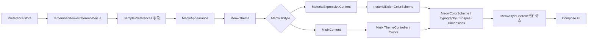
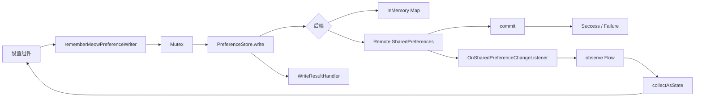
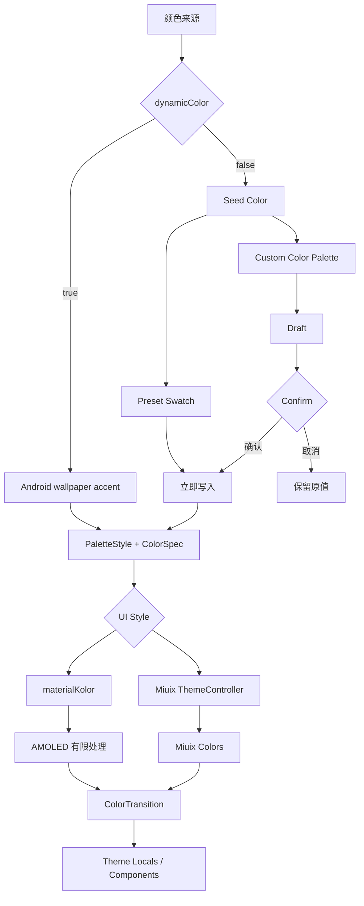

# MeowUI 主题、取色与设置持久化源码分析

## 0. 分析边界

本报告只完成源码研究和当前项目差距分析，不开始实现。

参考源码：`lingqiqi5211/MeowUI`，本地快照提交 `60bb989`。源码路径按 MeowUI 仓库相对路径记录。

结论分为三类：

- **源码证实**：直接来自类、函数、注释或测试。
- **代码推断**：根据实现结构推导，没有运行截图作为证据。
- **新增设计**：MeowUI 未提供，当前 KMP 项目需要自行补充。

---

## 1. MeowUI 已经解决的问题

### 1.1 统一外观配置

**源码证实。**

`meowui/src/main/kotlin/io/github/lingqiqi5211/meowui/theme/MeowAppearance.kt:1-85`

`MeowAppearance` 统一保存：

- UI 风格：Material 3 Expressive / Miuix。
- 明暗模式：System / Light / Dark。
- 动态取色开关。
- 自定义 seed color。
- palette style。
- color spec。
- Miuix Monet 开关。
- AMOLED 暗色。
- Blur、悬浮底栏、预测式返回、界面缩放。

`MeowAppearance` 是不可变配置对象，可同时传给：

- `MeowTheme(appearance)`：应用主题。
- `MeowAppearancePage`：设置页面。

这避免了主题应用和设置页各自维护一套状态。

### 1.2 统一主题入口和组件 token

**源码证实。**

`meowui/src/main/kotlin/io/github/lingqiqi5211/meowui/theme/MeowTheme.kt`

关键结构：

- `MeowTheme.invoke(style, ...)`：简化入口。
- `MeowTheme.invoke(appearance, ...)`：完整外观入口。
- `MaterialExpressiveContent`：Material 3 Expressive 分支。
- `MiuixContent` / `MiuixContentInner`：Miuix 分支。
- `MeowStyleContent`：组件内部风格分发。
- `MeowColorScheme`、`MeowTypography`、`MeowShapes`、`MeowDimensions`：跨风格语义 token。

`MeowTheme.kt:124-180` 的 dimensions 包含页面、分组、条目 padding 和 spacing。两套风格不共享具体控件外观，只共享业务语义和 token 角色。

### 1.3 系统明暗和手动明暗

**源码证实。**

`MeowThemeMode`：

- `System`：使用 `isSystemInDarkTheme()`。
- `Light`：强制亮色。
- `Dark`：强制暗色。

`MeowTheme.invoke(appearance)` 先解析一个 `darkTheme: Boolean`，再传给 Material 和 Miuix 两个分支。两套 UI 因此共享同一明暗决策。

### 1.4 动态取色和 seed color

**源码证实。**

`MeowColorPicker.kt:69-230`

主题颜色来源有两个：

1. `dynamicColor = true`：使用 Android 系统壁纸颜色。
2. `dynamicColor = false`：使用用户指定 seed color。

`ColorPickerContent` 在 Android 12+ 显示“Follow wallpaper”色块。用户选择 preset 或 custom seed 时：

```text
onDynamicColorChange(false)
onSeedColorChange(color)
```

即选择自定义颜色会明确关闭动态取色。

### 1.5 从 seed color 生成完整颜色方案

**源码证实。**

Material 3 分支：

`theme/MeowMaterialColorScheme.kt:19-82`

- 使用 `materialKolor.dynamicColorScheme`。
- 输入 seed、isDark、palette style、color spec、AMOLED。
- 输出完整 Material `ColorScheme`，包含 container、surface、fixed 等角色。
- `MeowPaletteStyle` 支持 TonalSpot、Neutral、Vibrant、Expressive、Rainbow、FruitSalad、Monochrome、Fidelity、Content。
- Spec 2025 只对 TonalSpot、Neutral、Vibrant、Expressive 启用，其余回退 Spec 2021。

Miuix 分支：

`theme/MeowTheme.kt:438-567`

- 使用 Miuix `ThemeController`。
- 动态取色可选择系统主色或 seed。
- palette style 转换为 Miuix palette style。
- color spec 转换为 Miuix spec。
- Miuix 自己生成完整 `Colors`。

因此 MeowUI 不是只改 primary，而是为两套设计体系分别生成完整配色。

### 1.6 AMOLED 的有限处理

**源码证实。**

`theme/MeowMaterialColorScheme.kt:69-96`

AMOLED 只影响 Material 分支，并且只压黑页面底层：

- `background`
- `surface`
- `surfaceDim`
- `surfaceContainerLowest`
- `surfaceContainerLow`
- `surfaceContainer`

保留：

- `surfaceContainerHigh`
- `surfaceContainerHighest`
- `surfaceBright`

原因是卡片、分组项和搜索框仍需要与纯黑页面形成层次。

Miuix 分支忽略 `amoledDarkEnabled`。这说明 AMOLED 不是无差别将整套方案改成黑色。

### 1.7 主题颜色过渡

**源码证实。**

`theme/MeowColorTransition.kt:1-80`

MeowUI 用一条 `Animatable` 进度对整套颜色列表进行插值：

- 首帧直接使用目标值。
- 目标变化时从当前显示值继续过渡。
- 每帧只写一次状态。
- 支持中途再次切换主题。

`MeowMaterialColorScheme.kt:101-225` 和 `MeowMiuixColors.kt:1-150` 分别把 Material/Miuix 的完整色角色序列化为列表，再还原。

当前项目没有对应动画机制。

### 1.8 完整取色交互

**源码证实。**

MeowUI 不只是一个颜色按钮。

`component/MeowColorPicker.kt`

- `MeowColorPickerDialog`：风格原生弹窗。
- `MeowColorPicker`：可嵌入页面的横向选择器。
- `ColorPickerContent`：动态取色、preset、custom 三类入口。
- `SchemeSwatch`：使用 seed 生成的实际配色绘制预览色块。
- `CustomColorSwatch`：彩虹入口。
- 选中态、Role.RadioButton、contentDescription 和触觉反馈。

自定义任意颜色：

`component/MeowColorPalette.kt:20-145`

- `MeowColorPalette` 封装 Miuix `ColorPicker` / `ColorPalette`。
- 支持 slider/grid 两种模式。
- slider 支持 HSV、OKHSV、OKLab、OKLCH。
- `MeowColorPaletteDialog` 使用草稿色，点击确认后一次性提交。
- 默认移除 alpha，适合 seed color。

交互语义：

- preset/动态取色色块：点击立即预览并写入。
- custom palette：拖动时只更新 draft，确认后提交。
- 外层 Done 只关闭主题色窗口，不负责提交 preset。

**代码推断。** 这形成了“色票即时预览、复杂取色确认提交”的双层语义。

### 1.9 取色预览性能

**源码证实。**

`MeowColorPicker.kt:550-610`

- 每个预览色块生成完整配色成本较高。
- 使用 `LruCache` 缓存最近 128 个 scheme。
- 在 `Dispatchers.Default` 后台生成。
- 未生成完成时使用 seed 与黑白混合的 placeholder。
- cache key 包含 seed、dark、palette、effective spec。

这套机制解决多个动态配色预览同时显示时的卡顿和旧配色闪现。

### 1.10 设置键、默认值和类型

**源码证实。**

`core/preference/PreferenceKey.kt`
`core/preference/PreferenceType.kt`

支持：

- Boolean
- Int
- Long
- Float
- String
- Set<String>

`PreferenceKey` 将 key name、type、default value 绑定在一起：

- name 必须非空。
- default value 必须符合 type。
- StringSet 默认值做防御性复制。
- read 无值时返回 key default。

sample 的主题键定义位于 `sample/.../MainActivity.kt:109-130`：

- `ui_style`
- `theme_mode`
- `dynamic_color`
- `palette_style`
- `color_spec`
- `seed_color`
- `miuix_monet`
- `amoled_dark`

### 1.11 设置状态和 Compose UI 的绑定

**源码证实。**

`preference/MeowPreferenceBinding.kt`

- `MeowPreferenceProvider` 通过 CompositionLocal 提供 `PreferenceStore`。
- `rememberMeowPreferenceValue` 使用 `store.observe(key)` 和 `collectAsState`。
- `rememberMeowPreferenceWriter` 将写操作包装为 suspend。
- `rememberMeowPreferenceState` 提供 MutableState 适配。
- `rememberMeowPreferenceConnectionState` 暴露存储连接状态。
- 多个写操作通过 Mutex 串行化。
- 写结果可统一回调。

`component/MeowStoredPreferences.kt` 将 key 绑定封装为：

- SwitchPreference
- CheckboxPreference
- SliderPreference
- PopupPreference
- TextInputPreference

Slider 在拖动期间使用 draft，抬手后只提交一次，避免逐帧写存储。

### 1.12 设置持久化后端

**重要结论：MeowUI core 不自带跨平台持久化后端。**

**源码证实。**

核心只定义：

- `PreferenceStore` 接口。
- `InMemoryPreferenceStore` 内存实现。

真正持久化在 `meowui-xposed`：

- `CorePreferenceStoreAdapter`
- `SharedPreferencesStoreBackend`
- `LibXposedPreferenceStore`
- `RemotePreferencesConnection`

存储位置由 libxposed/SharedPreferences 宿主决定。应用重启后的恢复依赖远程 preference 服务，不是 `rememberSaveable`。

后端行为：

- read：读取 SharedPreferences，失败时回退 default。
- observe：监听 SharedPreferences change，并先 emit 当前值。
- write：在 IO dispatcher 执行 `commit()`。
- delete/clear：返回真实 commit 结果。
- 连接断开：标记 Disconnected，read 回退 default，write 返回 NotConnected。
- 服务重连：迁移到新的 SharedPreferences snapshot，并刷新 listener。
- ClassCastException：读取回退 default。
- commit 失败：保留旧值并返回 Failure。

测试位于：

`meowui-xposed/src/test/.../LibXposedPreferenceStoreTest.kt`

覆盖类型、观察、断线、写失败、重连、delete/clear。

---

## 2. MeowUI 流程图

### 2.1 主题初始化与状态流



### 2.2 设置存储流程



### 2.3 取色与颜色方案



---

## 3. 可以直接借鉴的实现

1. `PreferenceKey + PreferenceType + default` 的类型契约。
2. `PreferenceStore.read/observe/write/delete/clear` 抽象。
3. 通过 CompositionLocal 提供 store，通过 Flow 驱动 Compose 状态。
4. 设置组件只负责 UI，不直接依赖具体存储。
5. 写入结果、连接状态和写入串行化。
6. `MeowAppearance` 统一配置对象。
7. ThemeMode / Dynamic / Seed / Palette / Spec 的职责划分。
8. AMOLED 只调整页面底层 surface。
9. 单进度全量颜色过渡。
10. 取色器的 preset、wallpaper、custom、preview、confirm/cancel 分层。
11. 配色预览异步生成、缓存和 placeholder。
12. 未知 key/default/type 的防御策略。

---

## 4. 不适合直接迁移的实现

1. `meowui` 是 Android Library，不能作为当前 `commonMain` 的直接依赖。
2. `android.os.Build`、`android.R.color.system_accent1_500`、`Activity`、`WindowCompat` 不能进入 commonMain。
3. libxposed 和远程 SharedPreferences 与当前项目无关。
4. `InMemoryPreferenceStore` 只适合测试或会话内状态，不解决重启恢复。
5. MeowUI 的 sample 将每个设置项拆成多个 PreferenceKey，再拼成 `MeowAppearance`；当前项目可简化为版本化配置对象，但必须保留 key/default 的稳定性。
6. MeowUI core 没有配置 schema version 和批量迁移器。
7. MeowUI 没有 iOS/Desktop/Web 的持久化后端。
8. MeowUI 的 ColorPicker 依赖 Miuix ColorPicker/ColorPalette 和 Android 弹窗适配；具体可复用部分需要按当前 KMP target 逐个验证。
9. materialKolor 是否支持当前 iOS/JS/Wasm target 尚未验证，不能直接加入版本目录。

---

## 5. 当前 KMP 项目现状

### 5.1 模块和 sourceSet

**源码证实。**

- 模块：`:shared`、`:androidApp`、`:desktopApp`、`:webApp`。
- shared target：Android、iOS、JVM、JS、Wasm。
- UI 公共代码位于 `shared/src/commonMain`。
- 平台实现分布在 `androidMain`、`iosMain`、`jvmMain`、`jsMain`、`wasmJsMain`。
- 当前已有 expect/actual 架构，可用于平台能力抽象。

依赖：

- Compose Multiplatform 1.12.1。
- Material3 1.12.0-alpha03。
- Miuix 0.9.4。
- Kotlin 2.4.20。
- 当前没有 materialKolor、DataStore、Multiplatform Settings。

### 5.2 当前主题入口

**源码证实。**

`shared/src/commonMain/kotlin/top/ghhccghk/yadea/ui/UiTheme.kt`

已有：

- `UiThemeStyle`: Miuix / Material3。
- `AppThemeMode`: System / Light / Dark。
- `AppAppearance`: uiStyle + themeMode。
- `AppColors`、`AppTypography`、`AppShapes`、`AppDimensions`。
- `AppDesign` CompositionLocal token。
- `AppStyleContent` 双分支。
- `AppTheme`。

当前 `AppTheme`：

- System 模式使用 `isSystemInDarkTheme()`。
- Material 使用 `lightColorScheme()` / `darkColorScheme()`。
- Miuix 使用 `ThemeController(Light/Dark)`。
- 两套主题已经共享 darkTheme。

### 5.3 当前设置状态

**源码证实。**

`UiTheme.kt:174-176`

```text
rememberAppAppearance() = rememberSaveable(...)
```

这只保证配置变更和部分系统状态恢复，不是应用重启持久化。

`SettingsScreen.kt` 只切换 `UiThemeStyle`，没有 UI 暴露：

- ThemeMode。
- DynamicColor。
- SeedColor。
- PaletteStyle。
- ColorSpec。
- AMOLED。

### 5.4 当前能力矩阵

| 能力 | 当前状态 | 证据 |
| --- | --- | --- |
| 跟随系统明暗 | 已有 | `AppThemeMode.System` + `isSystemInDarkTheme` |
| 手动 Light/Dark | 模型支持，设置 UI 未提供 | `AppThemeMode.Light/Dark`，SettingsScreen 无入口 |
| Android 动态取色 | 没有 | 未调用 dynamicLight/DarkColorScheme 或平台 accent API |
| 自定义 seed color | 没有 | `AppAppearance` 不含 seed |
| 调色板风格 | 没有 | 无 palette model |
| AMOLED | 没有 | 无配置和 surface 处理 |
| 主题切换动画 | 没有 | 主题 token 直接替换 |
| 全局 UI 更新 | 已有 | `AppTheme` + `AppDesign` |
| 设置重启恢复 | 没有 | 只有 rememberSaveable |
| 配置 schema/version | 没有 | AppAppearanceSaver 只有两个字段 |
| 颜色选择器 | 没有 | SettingsScreen 无 color picker |
| 内置主题预设 | 没有 | 无稳定 preset ID |
| 未知配置安全回退 | 部分 | enum Saver 有默认值；没有持久化格式版本 |
| 平台能力状态 | 没有 | 无 dynamic-color capability API |

### 5.5 当前硬编码和主题一致性

**源码证实。**

大部分公共 UI 已使用 `AppDesign`。仍存在的固定值：

- `UiTheme.kt` 的 status color、shape、dimensions 默认值。
- `MirrorPreviewPanel.kt` 的裁剪线宽、角标长度和 label width。
- `MirrorScreen.kt` 的主按钮高度。
- `SettingsScreen.kt` 的 Miuix 12.dp section padding。
- `UiComponents.kt` 的 FilterChip content padding。

这些多数是尺寸 token 尚未扩展，不是独立 ColorScheme。

`Hex.kt` 目前只提供 hex byte 格式化，不是颜色解析器。

### 5.6 当前缺口

1. 没有持久化 `PreferenceStore`。
2. 没有平台存储 expect/actual。
3. 没有完整主题配置模型和版本迁移。
4. 没有颜色来源模式。
5. 没有 Android 动态取色能力接口。
6. 没有 seed -> scheme 的 KMP 生成器。
7. 没有颜色选择器和预设 ID。
8. 没有 AMOLED。
9. 没有全量颜色过渡。
10. 没有设置写失败/读取异常 UI 状态。

---

## 6. 当前项目需要自行补充的部分

### 6.1 确认 MeowUI 不存在的新增设计

以下不能声称来自 MeowUI：

- 配置 schema version 和迁移链。
- 未知字段/未知枚举/损坏 JSON 的统一解码策略。
- iOS NSUserDefaults、Desktop 文件、JS/Wasm localStorage 或等价后端。
- 跨平台 dynamic-color capability model。
- KMP 侧的 Android/iOS/Desktop/Web 平台取色接口。
- 内置主题稳定 ID 和向后兼容注册表。
- 配置读写错误的统一结果类型。
- 设置导入导出，如项目确实需要。

### 6.2 需要先验证、再决定是否引入

- materialKolor 对 Android/iOS/JVM/JS/Wasm 的真实支持矩阵。
- Miuix ColorPicker/ColorPalette 在所有目标上的编译与交互能力。
- DataStore Multiplatform 对 iOS/JS/Wasm 的支持和依赖规模。
- russhwolf Multiplatform Settings 对当前 targets 的支持。
- 是否可使用纯 commonMain expect/actual + 原生存储，避免新依赖。

### 6.3 可以优先扩展的当前能力

- 扩展 `AppAppearance`，不要另建第二套 ThemeConfig。
- 扩展 `AppDesign`，不要绕过已有 token。
- 扩展 `AppStyleContent`，保持双 UI 架构。
- 使用现有 Kotlin coroutines Flow 和 Compose State。
- 使用现有 expect/actual sourceSet 边界。
- 保留 Miuix 0.9.4，不先升级 UI 依赖。

---

## 7. 下一阶段设计决策清单

在写实现代码前需要确认：

1. 设置存储是否要求所有平台重启恢复，还是 Android/Desktop 优先。
2. 配置保存格式使用 versioned JSON、typed key-value，还是二者组合。
3. dynamic color 是仅 Android，还是允许其他平台返回 capability unavailable。
4. seed color 使用 ARGB Int、hex string，还是独立 ColorValue。
5. 是否首发支持 AMOLED。
6. 是否首发支持 palette style，还是先保留扩展字段。
7. 是否使用 materialKolor，还是分别复用 Miuix Monet 和一个 KMP tonal palette 生成器。
8. 取色器是否直接包 Miuix ColorPicker/ColorPalette。
9. 设置写失败时是立即回滚、保留草稿，还是禁用后续设置。
10. 配置版本迁移失败时回退默认值还是保留 raw data 供修复。

---

## 8. 结论

MeowUI 已经解决：

- 双风格主题入口。
- ThemeMode。
- 动态取色和 seed color 的优先级。
- 完整颜色方案生成。
- palette style / color spec。
- AMOLED 的有限 surface 处理。
- 全套颜色动画。
- 完整取色器和配色预览。
- 类型化设置键和 Flow/Compose 状态绑定。
- Android 远程 SharedPreferences 持久化适配和失败处理。

MeowUI 没有解决：

- 当前项目的跨平台持久化后端。
- schema version 和迁移。
- 非 Android 平台的动态取色。
- 当前所有 KMP target 的颜色生成依赖兼容性。

因此，后续实现应优先移植 MeowUI 的模型、状态流和交互语义；持久化后端、版本迁移和平台 capability 必须作为当前 KMP 项目的新增设计。
