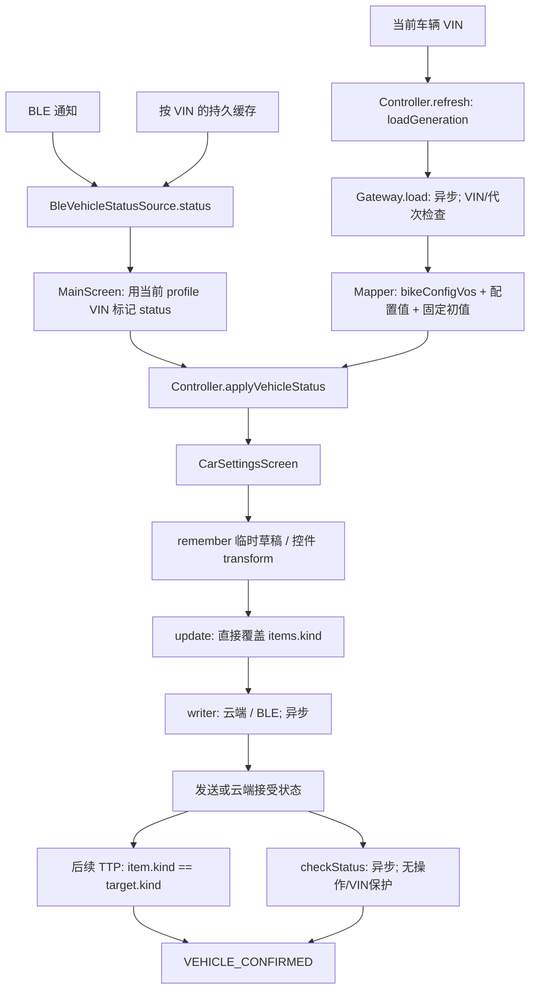
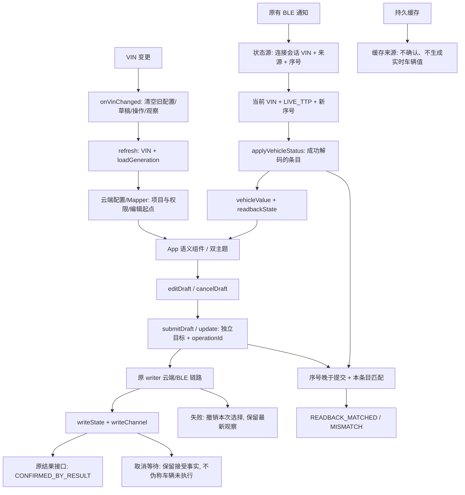

# 第八轮车辆设置状态模型审计

日期：2026-11-10。基线：`master / 14e7369`。本文件首先记录只读审计和设计，实施及验证结果在后续阶段追加。

## 1. 范围与安全基线

- 根目录 `AGENTS.md` 已读取。共享业务、双主题语义控件和现有命令映射继续复用。
- 初始 staged / unstaged 均为空。现有 untracked 日志、APK、截图、反编译输出、`docs/flutter/` 及用户审计文档全部保留，不加入本轮提交。
- 覆盖 `CarSettings.kt`、`CarSettingsGateway.kt`、`VehicleSettingCommands.kt`、`CarSettingsScreen.kt`、`MainScreen.kt`、`TtpInfo.kt`、`VehicleStatusSource.kt`、`BleVehicleStatusSource.kt` 及调用方和测试源码。
- 不涉及真实登录、云端写入、BLE 发送、OTA、数字车钥匙、自定义距离标定写入。

## 2. 原有状态字段职责

| 字段 | 原有生产者/位置 | 消费者 | 审计结论 |
| --- | --- | --- | --- |
| `CarSettingItem.kind` | Mapper、Controller 乐观更新、TTP 回填 | UI、writer | 混合配置初值、目标值、车辆值；无法区分来源 |
| `Toggle/Choice/Slider.valueKnown` | Mapper 初始值、UI 提交 transform、`withToggle/withIndex/withSlider` | Row 的显示与 enabled | 同时表示可信度和编辑资格，职责过多 |
| `Atmosphere.valueKnown` | 初始 false、提交 false | UI | 保持 UNKNOWN，但提交的 RGB 仍放进同一个 kind |
| `pendingIds` | `update()` 进入/返回 | UI 禁用、TTP 跳过回填 | 仅发送阶段阻止重复；轮询阶段已移除，旧轮询可覆盖新操作 |
| `confirmationStatuses` | writer 结果、轮询、TTP 对象相等 | 无逐条 UI 消费 | 混合发送事实和确认结果，且存在虚假 TTP 确认 |
| `loading/loadedFromCloud/loadGeneration/vin` | `refresh/clearForVin` | UI reset key、加载保护 | 加载有代次保护，写入/轮询没有对应保护；加载取消可能留下 loading=true |
| `latestVehicleStatus/generation` | `updateVehicleStatus` | refresh 回放、提交确认 | 异车包在过滤前已进入缓存；无实时/持久缓存来源区分 |
| 页面 Slider/Customize/Atmosphere draft | Composable `remember` | 提交 transform | 业务草稿散落 UI，页面退出会丢失；Slider 捕获旧 item |
| 密码 `writeState/cloudAccepted/bleSent` | 独立 PasswordController | 密码面板 | 独立链路，本轮保护，不混入普通设置模型 |
| `TtpInfo.extended` | `l76` 对应 parser | Controller 回填 | 仅是解析值，不包含 VIN、来源或接收代次 |

`selectedValue/enabled/isSaving/isPending` 并非普通设置模型的统一字段。`enabled` 是 UI 计算结果；没有独立的普通设置 writeState 或 vehicleValue。

## 3. 原有状态流转



原有边界：加载请求检查 VIN/代次；TTP 回填只检查 `_state.vin`；写入/轮询返回不检查 VIN/代次。取消被 `runCatching` 当作失败处理。refresh 清空全部确认与草稿。

## 4. 已确认问题

| ID | 位置（基线） | 问题 | 影响 |
| --- | --- | --- | --- |
| S8-01 | `CarSettings.kt:322-462` | 写入、debounce、轮询和 refresh 后没有操作/VIN/加载代次检查 | 旧 VIN 回调更新新车条目、消息、确认状态；延迟阶段可能提交新 VIN |
| S8-02 | `CarSettings.kt:354-358` | CancellationException 被吞掉；debounce 取消没有清理 pending | 页面退出可能留下 pending 或被误报保存失败 |
| S8-03 | `CarSettings.kt:494,697-703` | 发送中跳过回填；仅比较最终 item.kind 与目标 | WRITE_ONLY 条目收到任意 TTP 可被误报车辆确认；缺失字段也可能用旧值确认 |
| S8-04 | `CarSettings.kt:346-352,363-370` | 草稿覆盖车辆值，失败回滚整个旧 item | 目标值冒充车辆状态；丢失写入期间的新车辆值 |
| S8-05 | `MainScreen.kt:434-438`、`VehicleStatusSource` | TTP 流没有 VIN/实时性，当前 VIN 与旧 status 可能组合 | 切车及持久缓存可能被当作新车实时回读 |
| S8-06 | `CarSettingsScreen.kt:1324-1355` | UNKNOWN 禁用所有基本控件 | 无回读设置不能安全创建草稿；ID 50 不能只改 valueKnown=false |
| S8-07 | `CarSettings.kt:451-460` | 确认后全量 refresh | 清除其他并发设置的 pending/确认状态 |
| S8-08 | `CarSettingsGateway.kt:1660-1663` | ID 50 固定初始风格 1 且标已知 | 未收到车辆值也显示已知风格 |

## 5. 第七轮七项审计

| confId/条目 | 初始 | 当前回填字段与转换 | 有效值解除 UNKNOWN | 主要证据 |
| --- | --- | --- | --- | --- |
| 14 | Slider unknown | `alarmWarningMode`，0..7 | 是，`withSlider` 设 true | KMP `applyVehicleStatus:689`；Smali `l76.z:9757-9773` |
| 20 | Slider unknown | `alarmWarningVolumeLevel`，0..7 | 是 | `VehicleSettingViewModel:21715-21843`；`l76.z:9766-9773` |
| 21:time | Choice unknown | `withGoHomeTimeStatus`，合法选项索引 | 是 | `BackLightActivity`；VM:24128-24170；`l76.z:9371-9378` |
| 81:time | Choice unknown | 同上 | 是 | 同字段；现有选项文案差异不在状态修复中改动 |
| 27 | Choice unknown | `offModeStatus`，0..1 | 是 | VM:22625-22743；`l76.z:9389-9396` |
| 31 | Choice unknown | `metricSystemStatus`，0..1 | 是 | VM:22745 起；`l76.z:10025-10032` |
| 54 | Choice unknown | `voltageSettingStatus`，1..3 减 1 | 是 | VM:23219 起；`l76.z:11610-11617` |

以上是静态链路核查，非实车验证。缺失字段原样保留未知；有效回填会设 known。共同风险是写入期间跳过回填、草稿混入 kind、失败回滚旧对象、缺少回调 VIN 隔离。ID 14 原 App 另有 `alarmSensitivityStatus` 使用链，需独立核查；本轮不凭名称更换保护映射。

## 6. 增量状态模型设计（阶段 B）

设计采用现有 `CarSettingsState` 内按稳定条目 ID 保存的 `CarSettingValueState`，不新增配置体系，不改命令参数/编码。

- **定义/配置**：保留 `CarSettingItem.kind` 作为原有 Mapper/回填投影。初始值或云端配置不自动成为车辆真实值。
- **车辆观测**：最终采用 `VehicleSettingValue.Unknown/Known` 加独立 `SettingReadbackState`（UNKNOWN/VALID/MISSING_OR_INVALID/UNSUPPORTED）；Known 保存最近有效 kind、VIN、序号、LIVE_TTP 来源和实时性。解析层的 -1 混合了缺失与无效，不能编造更具体原因，也不能据此宣称车型不支持。UNSUPPORTED 仅保留表达能力，没有证据时不赋值。缓存不作为实时车辆值。
- **用户草稿**：`draftValue` 独立保存，Controller 提供编辑/取消方法。TTP 回填更新车辆值，不覆盖草稿。
- **提交目标**：`submittedValue` 和唯一 operationId 绑定 VIN/loadGeneration；每次 await 前后核对当前操作。失败仅移除草稿/提交目标，保留最新车辆观测。
- **写入事实**：IDLE、PREPARING、SUBMITTING、CLOUD_ACCEPTED、LOCAL_UPDATED、FAILED、CANCELLED。不虚构无法观测的发送子阶段。
- **确认结果**：UNKNOWN、WAITING_READBACK、READBACK_MATCHED、READBACK_MISMATCH、CONFIRMED_BY_RESULT、FAILED、TIMED_OUT。云端接受、BLE sink true 只更新写入事实。
- **兼容**：保留既有 confirmationStatuses 对外投影，但由独立事实计算；未映射字段不参与 TTP 确认。UI 两套风格仍由同一 App* 语义组件渲染。
- **VIN**：当前车辆变化先清空配置、草稿、观测和操作；状态源提供原子 VIN/来源/序号快照，设置层不把当前 profile VIN 临时贴给裸 TTP。
- **页面重建**：草稿与提交状态归 Controller；Composable 只控制弹层显示。进程重启丢失草稿并重新 UNKNOWN，不持久化为车辆值。
- **失败/取消**：失败保留错误；取消标记 CANCELLED 并继续抛出取消异常。未确认目标单独展示，不继续冒充车辆当前值。

## 7. ID 50 专项证据

- KMP 原 Mapper 固定 Choice index 0/三项、默认 known=true；写入已有 `COMMAND_BIKE_PANEL_THEME_TYPE / 0x3F / 0..2`，编码未在本轮修改。
- 原 `GaugeStyleHandOffActivity.getSettingConfigId():522-529` 返回 `50`；`onCheckChange():60-217` 的两个 RadioButton 分别提交参数 0/1；`refreshCheckBox():365-498` 以 S3 当前值恢复或 clearCheck。
- `VehicleSettingViewModel.S3():17113-17130` 实际返回 `F2`；VM:23170-23217 把 `TtpInfo.panelThemeCurrent` 填入 F2。
- `l76.z:9647-9654` 使用 `G(data,0x2E,0)` 解析 panelThemeCurrent。这是此前报告遗漏的新静态证据，不能继续声称原 App 没有该字段。
- `qg:6858-6876` 将命令名映射到 0x3F；`BleBicycleCommandManager.generateBleCommand:4358-4400` 为 7 字节 FF + `(parameter << 5) + 0x9F` + 17 字节 FF，外层继续复用原 SUM8。
- 最终处理：接入已核实的 `panelThemeCurrent`，只把原页面展示的 0/1 回填为风格；2 不作 UI 语义猜测，3 经原 G 解析为 -1。Mapper 初始 UNKNOWN，选项由三项收窄到原页面两项。UNKNOWN 下仍可编辑独立草稿；无新有效 TTP 时发送结果不生成车辆值。`VehicleSettingFrameEncoder` 和既有命令编码均未改动。

## 8. WRITE_ONLY/PARTIAL 与保护范围

WRITE_ONLY 候选 3/9/13/16/40/48/50/75/76/82/91/93 共同受 S8-03 影响：不具有回填分支的目标对象会原样保留并被误确认。应集中修正确认判定，而不补猜测字段。

PARTIAL 1/5/7/10/11/39/41/88/51/52/55/64/69/73/89/92/1005：普通设置共用上述 Controller 风险；41/88 自定义音效有独立 Controller 和服务器结果轮询；密码有独立状态机；未知的标定/灯光回读不因状态模型改造而开放。

保护 VS-013/014/015/016、X1 字符串 ID、0..7 距离、定时关机、TCS/ABS 二次确认和所有现有参数/协议。64/89 已知回填范围与历史修复报告不一致单独记录，本轮不修改其字段映射。

## 9. 验证计划与分层状态

初稿状态：`STRUCTURE_AUDITED / STATIC_FLOW_VERIFIED / PARTIAL`。

- 测试源码：七项 UNKNOWN→有效/无效回填、草稿/车辆值分离、写入失败/取消、异 VIN/代次回调、重复操作、无字段的 TTP 不能确认、ID 50 UNKNOWN 编辑。
- 测试须使用 fake writer/gateway/adapter，不依赖网络、账号或车辆；先编译测试源码，再仅运行确认纯本地的新测试。
- 计划编译：shared JVM/JS/WasmJs、compileTestKotlinJvm、Android assembleDebug、Desktop build。
- 本节截至初稿尚未执行编译/测试。`UNIT_TESTED/BUILD_VERIFIED/RUNTIME_VERIFIED/VEHICLE_VERIFIED` 不能据静态审计声明。

## 10. 实施结果

本轮采用兼容性增量修复，没有新增业务状态模型文件。模型放在既有 `CarSettings.kt`，配置/命令/双主题组件继续复用。以下行号以本轮实现附近位置为定位起点，方法名为稳定检索键。

| 问题 | 修复结果 | 分层状态 |
| --- | --- | --- |
| S8-01/02/07 | 写入、延迟、轮询检查 VIN/加载代次/operationId；加载取消可重试；取消继续抛出；移除确认后的全量 refresh | STATIC_FLOW_VERIFIED / UNIT_TESTED / BUILD_VERIFIED |
| S8-03 | 只有本次成功解析的字段才建立观察值；缺失字段、无映射条目、旧序号、缓存均不能确认 | STATIC_FLOW_VERIFIED / UNIT_TESTED / BUILD_VERIFIED |
| S8-04 | items.kind 不再写入乐观目标；draftValue/submittedValue 独立；发送时继续回填；失败只撤销本次选择 | STATIC_FLOW_VERIFIED / UNIT_TESTED / BUILD_VERIFIED |
| S8-05 | 原子 VIN/来源/序号快照；已有连接期间切 VIN 后拒绝旧连接通知，等待新会话；断线降为历史回读 | STATIC_FLOW_VERIFIED / UNIT_TESTED / BUILD_VERIFIED / PARTIAL（物理设备身份边界见第 14 节） |
| S8-06 | 未知 Toggle/Choice 用 AppActionPreference 打开明确选项；Slider 可编辑；不向 Miuix 传伪造选中项或 -1 | STATIC_FLOW_VERIFIED / BUILD_VERIFIED；视觉运行未验证 |
| S8-08 | ID 50 初始未知、两项选项、有证据 TTP 回填；本地选择与车辆值分别展示 | STATIC_FLOW_VERIFIED / UNIT_TESTED / BUILD_VERIFIED |
| 结果接口语义 | result=0 仅记录 CONFIRMED_BY_RESULT，兼容投影仍为 CLOUD_ACCEPTED，不成为车辆回读或 VEHICLE_CONFIRMED | STATIC_FLOW_VERIFIED / UNIT_TESTED / BUILD_VERIFIED |
| 51 时间同步 | 保留原有结果位解析/命令；结果位不再建立车辆真实值，避免旧结果被当成本次操作确认 | STATIC_FLOW_VERIFIED / UNIT_TESTED / BUILD_VERIFIED；事务相关性 BLOCKED |

## 11. 最终字段职责和更新规则

实现：`F:\android app code\toupin\shared\src\commonMain\kotlin\top\ghhccghk\yadea\carsetting\CarSettings.kt`，`CarSettingValueState`（约 157 行）、`CarSettingsController.update/applyVehicleStatus/reconcileObservation`。

| 字段 | 唯一职责 | 不代表什么 |
| --- | --- | --- |
| items.kind / valueKnown | 兼容现有定义、配置初值、旧回填投影；with* 的 known 表示该投影解码成功 | 不是新 UI 的车辆值或写入确认来源 |
| vehicleValue | 最近有效的、指定 VIN 的 TTP 观察值；有来源/序号/live | 非草稿、非云端期望、非持久缓存 |
| readbackState | 最新字段有效性；无效/缺失不删除最近有效观察 | -1 不等于不支持；UNSUPPORTED 无证据不推断 |
| draftValue | Controller 中尚未提交的用户编辑 | 不改变 vehicleValue；不标记确认 |
| submittedValue | 当前操作目标/未确认的本次选择 | 不是车辆当前值 |
| operationId + 私有 WriteOperation | 条目操作身份、提交 VIN、loadGeneration | 不改变命令参数 |
| writeState / writeChannel | 实际到达的提交阶段/返回通道 | BLE sink true 不代表车辆执行；云端接受不等于确认 |
| confirmationState | UNKNOWN/等待/新回读一致或不一致/结果接口确认/失败/超时 | CONFIRMED_BY_RESULT 不代表实时车辆值 |
| error | 条目失败信息，直到下一次编辑/提交；不含敏感参数 | 不会因其他条目操作而被整体旧对象恢复 |
| pendingIds | 发送和轮询中禁用条目；finally 清理 | 不再阻止 TTP 回填 |
| confirmationStatuses | 从 valueStates 计算的兼容只读投影 | 不独立赋值；仅 READBACK_MATCHED 投影 VEHICLE_CONFIRMED |

**TTP**：来源必须是 LIVE_TTP；VIN 匹配；来源序号未消费；有效字段写入观察值和 VALID，解除 UNKNOWN。没有成功解码时不构造观察值；此前有效值保留并标 MISSING_OR_INVALID。断线值保留为非实时历史。UI 明示 UNKNOWN/历史，不用这些值确认新操作。

**编辑**：editDraft 使用独立草稿，验证类型、Choice 索引、Slider 范围及已有 minimumNonZero。cancelDraft 撤销草稿；TTP 更新不触碰草稿。未获取车辆值时，编辑器中的初始位置仅是编辑起点，不作为观察值。

**提交**：update/submitDraft 固定目标与唯一 operationId，记录提交前观察代次，所有异步边界校验 VIN/加载代次/操作身份。相同条目轮询期间拒绝重复提交，其他条目独立。

**失败/取消**：写入失败清理草稿/目标，保留写入期间最新车辆值。云端已接受后的结果失败/超时单独记录确认失败/超时，不抹掉 CLOUD_ACCEPTED 事实。收到发送回执前取消为 CANCELLED；回执后取消确认等待，不撤销已经发生的接受事实，后续匹配 TTP 仍可确认。取消不伪造车辆未执行。

**确认**：必须是提交开始之后、当前 VIN、本条目实际成功解码的新观察且值一致；无关 TTP 或旧字段相等不能确认。Customize 必须四字段均有效，不能用旧值/默认值拼成完整确认。51 结果位缺少事务相关证据，不参与实际值确认。TTP 不一致与确认超时均不修改协议。

## 12. 修复后状态流



页面重建仍使用同一 Controller 时保留草稿/结果；VIN 或显式 refresh 会重置。进程重建不保存这些状态，重新 UNKNOWN，不把草稿写入长期存储。Composable 只保存弹层显示/导航，不持有普通设置的业务草稿。密码输入仍使用原有专属短期状态，本轮未改。

## 13. 七项、WRITE_ONLY 与 PARTIAL 逐项结论

第 5 节七项不是“只修改 valueKnown=false 就结束”：原有效 with* 回填会解除未知，本轮补齐独立观察有效性、草稿分离、失败恢复和 VIN/来源保护。七项均通过一个逐条断言的纯本地测试；字段缺失、异 VIN、后续无效值均检查。**这仅验证现有映射的状态行为，不代表证明所有历史字段的业务语义正确。** ID 14 的候选字段差异仍列为 PARTIAL，不擅自替换。

下表的云端字段仅为现有 KMP 配置来源，不新增协议语义。文件简称 C=`CarSettings.kt`，G=`CarSettingsGateway.kt`，V=`VehicleSettingCommands.kt`；均位于上文仓库的 `shared/src/commonMain/kotlin/top/ghhccghk/yadea/carsetting/`。

| WRITE_ONLY 候选 | 当前来源/写入入口 | 本轮状态结论 |
| --- | --- | --- |
| 3 携出助力 | G.kindOf unknownToggle；V.forConfigId 3 | 无回填分支，车辆值 UNKNOWN；无关 TTP 不确认 |
| 9 信息提醒 | G alarmOn / 云端写入 | 云端配置不提升为观察值；CLOUD_ACCEPTED 与确认分开 |
| 13 报警音 | G alarmSoundEnable / V 13 | 同上；BLE 回执只能 LOCAL_UPDATED |
| 16 倾倒报警 | G dumpAlarm / 云端 | 不误用 32 的 tiltWarningStatus；无独立回读仍 UNKNOWN |
| 40 彩蛋音效 | G colorEggSoundEffect / 云端分流 | 不把配置值或接受结果当车辆值 |
| 48 充电上限 | G kindOf 48 / 既有 BLE/云端 | 不新增 TTP 语义，目标值与观察值分开 |
| 50 仪表风格 | 第 7 节已闭环的 panelThemeCurrent | 本轮增加可靠静态回填，不再简单列作 WRITE_ONLY；未收到时仍可编辑 UNKNOWN |
| 75 定位器防盗 | G tamperProofIotEnable / 云端 | 只有接受/结果事实，无新车辆回读 |
| 76 定位开关 | G positioningFunc / param-setting | 同上 |
| 82 电话告警 | G lowBatTelWarning / 云端 | 同上 |
| 91 SOS | G sosEmergencyCall / 云端 | 同上，不影响独立联系人业务 |
| 93 静音 | G unknownToggle / 既有 V 93 | 不改 0x141 类别、字段方向或帧；车辆值 UNKNOWN |

上述普通条目：STATIC_FLOW_VERIFIED；公共状态机 UNIT_TESTED/BUILD_VERIFIED。不是所有车型逐项真机验证；云端端到端和车辆执行仍未验证。

| PARTIAL 项 | 状态审计/处理 | 剩余风险或缺口 |
| --- | --- | --- |
| 1 一键开机 | bleKeyStatus/DistanceLevel 的原回填保留；0..7 草稿独立；VIN 隔离 | 自动/自定义标定继续只读 |
| 5 车辆音效 | 云端选择仅编辑起点；本地选择不替代车辆值 | 无可靠 TTP 回读 |
| 7 自动落锁 | 原云端/拆分时间保留；统一未知、草稿、写入阶段 | 时间回读字段未闭环 |
| 10 电子围栏 | 云端半径/开关与实际值分开；查询结果不算车辆值 | 无车辆回读 |
| 11 自动开关机 | 已映射部分保留；不拼造新确认 | 其他子字段回读未闭环 |
| 39 边撑自动关机 | 依赖提示和既有命令保留；普通状态机隔离 | 时间确认不完整 |
| 41/88 自定义音效 | 独立 CustomSoundController，不纳入普通模型 | PARTIAL：refresh/setEnabled/apply/delete/rename/addFromUrl 缺 VIN/代次返回校验；runCatching 吞取消；enabled/selected 值混合云端与乐观值。仅记录，未重构或修改音效链路 |
| 51 仪表时间同步 | syncTimeResultStatus 不再作为真实设置或本次事务确认 | 新旧结果相关性 BLOCKED；Smali VM:23115 起写 D2，l76:11530/11539 为结果字段 |
| 52 手动距离 | 原可用基础字段/写入保留；云端值不作为车辆值 | 自定义标定仍 BLOCKED，未开放写入 |
| 55 FREE | 四字段不足时不构造完整实际值/确认；草稿归 Controller | 四字段部分可用不等于全部可确认；FREE 内 TCS 子控件已有交互未重写 |
| 64 辅助推行 | 不改映射/命令；只使用公共状态隔离与草稿 | 当前回填仍 1..3 与历史 0..2/变体证据不一致，保护约束下只记录 PARTIAL |
| 69 雷达 | fcw/rcw/bsd 独立观察/稳定 ID，不互相确认 | 车型实际能力未验证 |
| 73 氛围灯 | 开关 ambientStatus 保留；配置/RGB 草稿独立，0xF7 回执不产生真实 RGB | 模式、方向、RGB 回读继续 UNKNOWN/BLOCKED |
| 89 辅助推行变体 | 与 64 同样保护，不合并字符串 ID/参数 | 历史变体回填差异 PARTIAL，未擅改 |
| 92 自定义骑行 | 与 55 共用类型但独立条目；完整四字段才建立观察值 | 同 55 |
| 1005 自定义按键 | 原 customFunctionShort/Long 解码不变；子面板改用同一状态 Row | 不用未知初始 index0 冒充实际功能；按键功能语义不变 |

## 14. VIN、异步和能力边界

- `CarSettingsController.onVinChanged` 清空旧状态；loadGeneration 使同 VIN 重新加载也失效旧操作。debounce、writer 返回、checkStatus 前后均检查 WriteOperation。
- `CloudCarSettingWriter` 在 BLE fallback 返回和云端 update 前后校验 VIN，防止旧 BLE 失败后启动新 VIN 的云端回退。底层已发出的请求无法被事后撤销，Controller 只拒绝旧回调。
- MainScreen 使用 `VehicleStatusSource.observation`，不再用 profile VIN 给裸 TTP 重新标记。相同内容的实时包也因序号不同能触发回填。
- `BleVehicleStatusSource` 仅增加观测元数据及既有连接状态观察，不改变连接、通知订阅、MTU、帧、发送、OTA。已有活跃连接期间换 VIN 后不将该连接继续绑定给新 VIN；等待新会话。
- **PARTIAL**：BleNotification 没有设备身份/硬件 VIN，无法证明平台层排队的旧设备通知一定不跨越重连；没有修改平台适配器补身份。源对象更换/跨线程高并发及真实重连时序未运行验证。当前生产注入来源是 Android MainActivity 的 profile VIN 流；其他平台无来源时保持 UNKNOWN，不伪造支持。
- 缓存仍可供原车辆信息页历史展示，但设置确认不消费缓存。断线/无有效字段后 UI 标 UNKNOWN 并注明最近历史回读。
- `updateVehicleStatus(vin,status)` 保留兼容/纯本地测试入口，调用者须提供可信实时 VIN；当前生产普通设置入口已全部切到 observation。密码和其他页面原独立状态收集链未声称已统一完成。

## 15. 修改文件与提交范围

所有文件以 `F:\android app code\toupin\` 为根，未改任何平台 SourceSet、BLE 帧编码或密码实现。

| 文件 | 原问题 / 修改 | 是否涉及协议 |
| --- | --- | --- |
| shared/src/commonMain/kotlin/top/ghhccghk/yadea/carsetting/CarSettings.kt | 增量模型、草稿、操作隔离、TTP 有效性、新确认判定、失败/取消；50 已证据回填，51 不冒充实际值 | 不改变写入协议；新增有 Smali 依据的 50 读取映射 |
| shared/src/commonMain/kotlin/top/ghhccghk/yadea/carsetting/VehicleSettingCommands.kt | 仅 CloudCarSettingWriter 异步 VIN guard | 命令表/参数未改 |
| shared/src/commonMain/kotlin/top/ghhccghk/yadea/carsetting/CarSettingsGateway.kt | 仅 ID50 两选项、初始 unknown | 不改请求、类型或云端字段 |
| shared/src/commonMain/kotlin/top/ghhccghk/yadea/vehicle/TtpInfo.kt | 仅 panelThemeCurrent=G(data,0x2E,0)，缺失默认 -1 | 有证据的读取；不改现有字段 |
| shared/src/commonMain/kotlin/top/ghhccghk/yadea/vehicle/VehicleStatusSource.kt | 统一 VIN/来源/序号观测接口，空实现明确无值 | 无 |
| shared/src/commonMain/kotlin/top/ghhccghk/yadea/vehicle/BleVehicleStatusSource.kt | 实时/缓存/陈旧分流，会话绑定；去掉缓存恢复日志中的 VIN | 无帧/连接操作改动 |
| shared/src/commonMain/kotlin/top/ghhccghk/yadea/ui/screens/MainScreen.kt | VIN 清理和原子观测收集 | 无 |
| shared/src/commonMain/kotlin/top/ghhccghk/yadea/ui/screens/CarSettingsScreen.kt | App* 双主题组件；实际/草稿/目标/结果分别展示；未知可编辑；Slider 不再捕获旧条目 | 无；原安全开关二次确认保留 |
| shared/src/jvmTest/kotlin/top/ghhccghk/yadea/carsetting/EighthRoundStateIsolationTest.kt | 新增 7 项操作/VIN/取消假依赖测试 | 不触发真实操作 |
| shared/src/jvmTest/kotlin/top/ghhccghk/yadea/carsetting/EighthRoundValueStateTest.kt | 新增独立值、初值、确认、ID50、结果位、取消等待测试 | 同上 |
| shared/src/jvmTest/kotlin/top/ghhccghk/yadea/vehicle/EighthRoundObservationTest.kt | 新增缓存/同包序号/VIN 会话假适配器测试 | 所有真实适配器方法禁止调用 |
| shared/src/jvmTest/kotlin/top/ghhccghk/yadea/carsetting/CloudSettingStatusPollingTest.kt | 更新结果接口不冒充车辆确认、失败/超时消息与状态断言 | FakeTransport，无网络 |
| docs/vehicle-settings/eighth-round-state-model-audit.md | 阶段 A/B 初稿和最终审计/验证/剩余问题 | 无 |

| 提交 | 实际范围 |
| --- | --- |
| 0c67811 | 本审计文档初稿，先于代码修改 |
| ba73283 | CarSettings、VehicleSettingCommands、MainScreen、EighthRoundStateIsolationTest |
| 9117e93 | CarSettings、CarSettingsScreen、EighthRoundValueStateTest |
| af8d28f | CarSettings、CarSettingsScreen、MainScreen、VehicleStatusSource、BleVehicleStatusSource、EighthRoundObservationTest |
| 489c592 | CarSettings、CarSettingsGateway、TtpInfo、EighthRoundValueStateTest |
| 7297006 | EighthRoundValueStateTest：按稳定 ID 取夹具 |
| 5e9aed4 | CarSettings、CarSettingsScreen、CloudSettingStatusPollingTest、EighthRoundValueStateTest |
| 135c4ef | CarSettings、CloudSettingStatusPollingTest、EighthRoundValueStateTest：保留确认停止后的写入事实 |

最终文档单独提交，不修改既有历史。本文件自身最终提交 hash 由交付日志引用，避免自引用。

## 16. 测试与构建记录

全部使用 `$env:GRADLE_USER_HOME = 'C:\Users\DozenOregano696\.gradle'` 和已有缓存，追加 `--offline`，未更换缓存、未重新联网下载。

实际已运行并成功：

```powershell
.\gradlew.bat :shared:compileKotlinJvm :shared:compileKotlinJs :shared:compileKotlinWasmJs :shared:compileTestKotlinJvm --offline
.\gradlew.bat :shared:compileTestKotlinJvm --offline
.\gradlew.bat :androidApp:assembleDebug :desktopApp:build --offline
```

测试仅执行经源码确认的纯本地过滤目标，未运行整个 jvmTest。最终 XML 汇总为 **44 个测试，0 failures，0 errors，0 skipped**，其中本轮新增三个类共 21 个。ID50 新夹具曾因对 Mapper 结果使用无条件 single() 失败 1 次；改为稳定 ID 查找后重跑通过。没有将该失败隐藏为一次性全绿，也没有修改 Mapper 以迎合夹具。

最终实际过滤命令（此前还运行过其中新增三类的子集，均未运行完整测试套件）：

```powershell
.\gradlew.bat :shared:jvmTest `
  --tests 'top.ghhccghk.yadea.carsetting.EighthRoundValueStateTest' `
  --tests 'top.ghhccghk.yadea.carsetting.EighthRoundStateIsolationTest' `
  --tests 'top.ghhccghk.yadea.vehicle.EighthRoundObservationTest' `
  --tests 'top.ghhccghk.yadea.carsetting.CloudSettingStatusPollingTest' `
  --tests 'top.ghhccghk.yadea.carsetting.FifthRoundX1MappingTest' `
  --tests 'top.ghhccghk.yadea.carsetting.FifthRoundPasswordTest' `
  --tests 'top.ghhccghk.yadea.carsetting.FifthRoundDistanceRegressionTest' `
  --tests 'top.ghhccghk.yadea.carsetting.SixthRoundReviewTest' `
  --tests 'top.ghhccghk.yadea.carsetting.SixthRoundActivityBatchTest' `
  --tests 'top.ghhccghk.yadea.carsetting.SeventhRoundUnknownValueTest' `
  --tests 'top.ghhccghk.yadea.carsetting.CarSettingsControllerTest.bleWriteRemainsUnconfirmedUntilNewMatchingTtp' `
  --tests 'top.ghhccghk.yadea.carsetting.CarSettingsControllerTest.customKeyFunctionsReadBackFromCustomFunctionBits' --offline
```

| 过滤目标 | 实际执行数 | 结果 |
| --- | --- | --- |
| EighthRoundValueStateTest | 11 | 通过 |
| EighthRoundStateIsolationTest | 7 | 通过 |
| EighthRoundObservationTest | 3 | 通过 |
| CloudSettingStatusPollingTest | 6 | 通过 |
| FifthRoundX1MappingTest | 3 | 通过 |
| FifthRoundPasswordTest | 2 | 通过 |
| FifthRoundDistanceRegressionTest | 1 | 通过 |
| SixthRoundReviewTest | 4 | 通过 |
| SixthRoundActivityBatchTest | 2 | 通过 |
| SeventhRoundUnknownValueTest | 3 | 通过 |
| CarSettingsControllerTest 两个明确方法 | 2 | 通过 |

验证产物（未提交）：`F:\android app code\toupin\shared\build\test-results\jvmTest\TEST-*.xml`。最终共享编译及测试源码编译通过（21 秒），最终过滤测试 BUILD SUCCESSFUL（5 秒）；最后一次 Android assembleDebug/Desktop build 为 BUILD SUCCESSFUL（19 秒）。重复执行的独立 compileTestKotlinJvm 也通过（2 秒）。

第七轮七项在新测试中逐条检查 UNKNOWN、正确/错误 VIN、有效/缺失回填。草稿、发送中回填、失败保留最新值、旧值不能确认、写入-only 不受无关包确认、ID50 G 位域/0/1 选项、51 结果位隔离都有纯本地断言。

`UNIT_TESTED` 只适用于实际执行的这些断言；不是全部历史测试通过声明。Desktop build 的 test 为 NO-SOURCE；共享测试仅由上述明确过滤任务运行。iOS 未在 Windows 构建；Miuix/Material3 深浅色/窄宽屏未启动应用做视觉运行检查，以避免意外联网，不能标 RUNTIME_VERIFIED。真实登录、云端、BLE、车辆均未验证。

## 17. 未解决事项与后续优先级

1. **PARTIAL，优先级高**：41/88 独立 CustomSoundController 的 VIN/请求代次、取消、写入事实模型；应独立修复并使用假 Gateway 回归，不混入音效上传或协议改造。
2. **BLOCKED/PARTIAL**：64/89 既有代码与历史变体证据冲突；ID14 alarmWarningMode 与另一路 alarmSensitivityStatus 的页面业务对应仍需专项核对。未凭名称改映射。
3. **BLOCKED**：氛围灯模式/方向/RGB 回读与自定义距离标定闭环。未制造字段、标定结果或新命令。
4. **PARTIAL**：51 的操作型语义/本次事务关联、云端结果接口只有 configId 的请求相关性；不将结果当车辆实时值或新的物理执行证明。
5. **PARTIAL**：新连接会话下平台通知的物理身份、源对象替换、并发压力、实际页面生命周期；本轮仅静态和 fake 验证。
6. **未验证**：所有本轮修改的真实车辆表现；需用户明确授权与实车反馈。以前用户验证正常是既有基线，不等于本轮 Agent 已再次实车验证。

总体：公共普通设置状态模型和 ID50 修复达到 STATIC_FLOW_VERIFIED / UNIT_TESTED / BUILD_VERIFIED；全模块仍 PARTIAL，未声明 RUNTIME_VERIFIED 或 VEHICLE_VERIFIED。

## 18. 最终问题逐项回答

1. 原结构把定义/默认、期望值和车辆值混放在 kind，确认逻辑依赖对象相等，并跳过发送中的回填；回滚旧对象和缺少操作隔离会丢失新状态。
2. valueKnown 原本承担可信度和编辑资格。现在保留旧投影兼容性，但实际值、草稿、写入和确认由不同字段承担，UI 不再用该布尔值判定全部状态。
3. 七项原代码均能通过有效 with* 解除 UNKNOWN，本轮已逐条验证状态路径；ID14 字段语义差异仍需专项核对，不能把状态测试当业务协议证明。
4. 存在旧 VIN 回调/缓存混用风险；普通 Controller 和当前生产来源已修复相应隔离。独立音效、物理通知身份和真实并发边界仍 PARTIAL。
5. 普通设置的草稿/目标与车辆观察已分离，失败不回滚旧车辆对象。独立密码/音效状态机未宣称彻底统一。
6. 普通设置的云端接受、BLE 通道回执、结果接口确认和匹配回读已分离。只有新匹配回读投影为 VEHICLE_CONFIRMED；结果接口/超时/取消不抹去已接受事实。
7. ID50 在 UNKNOWN 下可安全创建草稿并提交；同时新找到真实 TTP 字段证据，接入 0/1 只读回填。没有回读时绝不以提交值补值。
8. 普通 WRITE_ONLY 项不会因任意 TTP 被虚假确认；云端配置不是车辆值。独立音效仍有自己的状态缺口，不能声称全模块无风险。
9. 已修复项见第 10 节及逐文件清单；没有改 BLE 命令/帧或受保护字段映射。
10. 氛围灯未知回读、自定义标定、51 事务相关性、ID14/64/89 证据差异仍 BLOCKED/PARTIAL。
11. 实际执行仅第 16 节明确的本地过滤目标，共 44 项；没有全量 jvmTest、真实网络或车辆操作。
12. shared JVM/JS/Wasm、测试源码、Android Debug 与 Desktop build 均进行编译/构建验证；iOS 未构建。
13. 没有启动真机或车辆验证，也没有进行双主题实际截图检查；已有用户实车反馈仅作为保护基线。

## 19. Git 交付检查

- 分支仍为 master；没有重写历史、切换用户分支或清理工作区。
- 功能与文档按独立提交交付。所有提交前执行 git diff --check；add/commit 均使用精确文件 pathspec。没有推送远端。
- 本轮所有代码与测试源码已提交；最终报告也单独提交。tracked staged/unstaged 最终应为空，以交付前实际 git status 为准。
- 保留的原有 untracked：desktopApp/yadea-mirror-log.txt、shared/yadea-mirror-log.txt、docs/ble-cross-platform-implementation-plan.md、docs/bluetooth-kmp-audit.md、docs/flutter/、docs/ui/ui-optimization-execution-plan.md、jadx-single-skin-generator.java、jadx-single-skin.java、jadx-toupinNew/、toupinNew.apk、yadea.apk、原app设置截图/。
- APK、日志、截图、反编译输出、Gradle 测试/构建产物均未加入本轮提交。无 reset/clean 操作。
