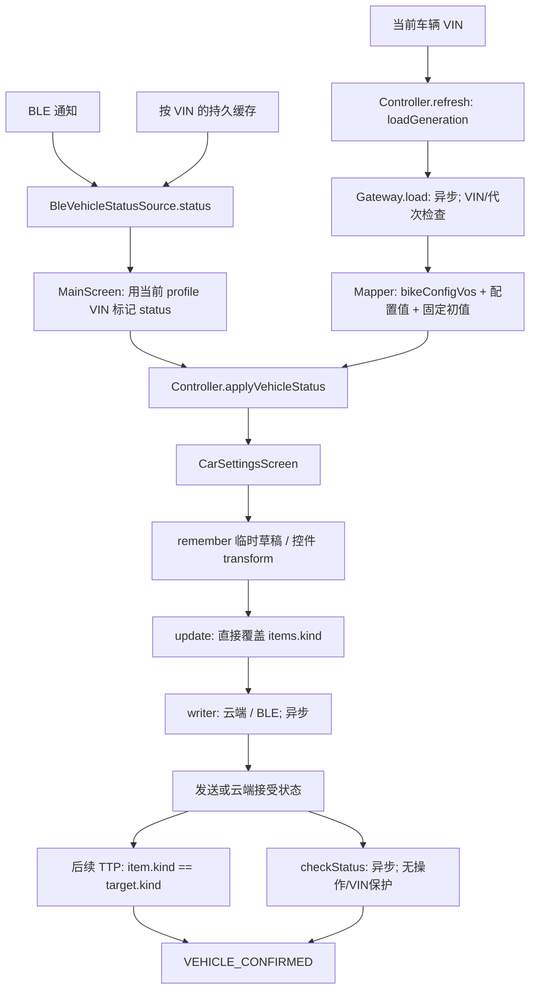

# 第八轮车辆设置状态模型审计

日期：2026-11-10。基线：`master / 14e7369`。本文件首先记录只读审计和设计，实施及验证结果在后续阶段追加。

## 1. 范围与安全基线

- 根目录 `AGENTS.md` 已读取。共享业务、双主题语义控件和现有命令映射继续复用。
- 初始 staged / unstaged 均为空。现有 untracked 日志、APK、截图、反编译输出、`docs/flutter/` 及用户审计文档全部保留，不加入本轮提交。
- 覆盖 `CarSettings.kt`、`CarSettingsGateway.kt`、`VehicleSettingCommands.kt`、`CarSettingsScreen.kt`、`MainScreen.kt`、`TtpInfo.kt`、`VehicleStatusSource.kt`、`BleVehicleStatusSource.kt` 及调用方和测试源码。
- 不涉及真实登录、云端写入、BLE 发送、OTA、数字车钥匙、自定义距离标定写入。

## 2. 原有状态字段职责

| 字段 | 原有生产者/位置 | 消费者 | 审计结论 |
| --- | --- | --- | --- |
| `CarSettingItem.kind` | Mapper、Controller 乐观更新、TTP 回填 | UI、writer | 混合配置初值、目标值、车辆值；无法区分来源 |
| `Toggle/Choice/Slider.valueKnown` | Mapper 初始值、UI 提交 transform、`withToggle/withIndex/withSlider` | Row 的显示与 enabled | 同时表示可信度和编辑资格，职责过多 |
| `Atmosphere.valueKnown` | 初始 false、提交 false | UI | 保持 UNKNOWN，但提交的 RGB 仍放进同一个 kind |
| `pendingIds` | `update()` 进入/返回 | UI 禁用、TTP 跳过回填 | 仅发送阶段阻止重复；轮询阶段已移除，旧轮询可覆盖新操作 |
| `confirmationStatuses` | writer 结果、轮询、TTP 对象相等 | 无逐条 UI 消费 | 混合发送事实和确认结果，且存在虚假 TTP 确认 |
| `loading/loadedFromCloud/loadGeneration/vin` | `refresh/clearForVin` | UI reset key、加载保护 | 加载有代次保护，写入/轮询没有对应保护；加载取消可能留下 loading=true |
| `latestVehicleStatus/generation` | `updateVehicleStatus` | refresh 回放、提交确认 | 异车包在过滤前已进入缓存；无实时/持久缓存来源区分 |
| 页面 Slider/Customize/Atmosphere draft | Composable `remember` | 提交 transform | 业务草稿散落 UI，页面退出会丢失；Slider 捕获旧 item |
| 密码 `writeState/cloudAccepted/bleSent` | 独立 PasswordController | 密码面板 | 独立链路，本轮保护，不混入普通设置模型 |
| `TtpInfo.extended` | `l76` 对应 parser | Controller 回填 | 仅是解析值，不包含 VIN、来源或接收代次 |

`selectedValue/enabled/isSaving/isPending` 并非普通设置模型的统一字段。`enabled` 是 UI 计算结果；没有独立的普通设置 writeState 或 vehicleValue。

## 3. 原有状态流转

原有边界：加载请求检查 VIN/代次；TTP 回填只检查 `_state.vin`；写入/轮询返回不检查 VIN/代次。取消被 `runCatching` 当作失败处理。refresh 清空全部确认与草稿。

## 4. 已确认问题

| ID | 位置（基线） | 问题 | 影响 |
| --- | --- | --- | --- |
| S8-01 | `CarSettings.kt:322-462` | 写入、debounce、轮询和 refresh 后没有操作/VIN/加载代次检查 | 旧 VIN 回调更新新车条目、消息、确认状态；延迟阶段可能提交新 VIN |
| S8-02 | `CarSettings.kt:354-358` | CancellationException 被吞掉；debounce 取消没有清理 pending | 页面退出可能留下 pending 或被误报保存失败 |
| S8-03 | `CarSettings.kt:494,697-703` | 发送中跳过回填；仅比较最终 item.kind 与目标 | WRITE_ONLY 条目收到任意 TTP 可被误报车辆确认；缺失字段也可能用旧值确认 |
| S8-04 | `CarSettings.kt:346-352,363-370` | 草稿覆盖车辆值，失败回滚整个旧 item | 目标值冒充车辆状态；丢失写入期间的新车辆值 |
| S8-05 | `MainScreen.kt:434-438`、`VehicleStatusSource` | TTP 流没有 VIN/实时性，当前 VIN 与旧 status 可能组合 | 切车及持久缓存可能被当作新车实时回读 |
| S8-06 | `CarSettingsScreen.kt:1324-1355` | UNKNOWN 禁用所有基本控件 | 无回读设置不能安全创建草稿；ID 50 不能只改 valueKnown=false |
| S8-07 | `CarSettings.kt:451-460` | 确认后全量 refresh | 清除其他并发设置的 pending/确认状态 |
| S8-08 | `CarSettingsGateway.kt:1660-1663` | ID 50 固定初始风格 1 且标已知 | 未收到车辆值也显示已知风格 |

## 5. 第七轮七项审计

| confId/条目 | 初始 | 当前回填字段与转换 | 有效值解除 UNKNOWN | 主要证据 |
| --- | --- | --- | --- | --- |
| 14 | Slider unknown | `alarmWarningMode`，0..7 | 是，`withSlider` 设 true | KMP `applyVehicleStatus:689`；Smali `l76.z:9757-9773` |
| 20 | Slider unknown | `alarmWarningVolumeLevel`，0..7 | 是 | `VehicleSettingViewModel:21715-21843`；`l76.z:9766-9773` |
| 21:time | Choice unknown | `withGoHomeTimeStatus`，合法选项索引 | 是 | `BackLightActivity`；VM:24128-24170；`l76.z:9371-9378` |
| 81:time | Choice unknown | 同上 | 是 | 同字段；现有选项文案差异不在状态修复中改动 |
| 27 | Choice unknown | `offModeStatus`，0..1 | 是 | VM:22625-22743；`l76.z:9389-9396` |
| 31 | Choice unknown | `metricSystemStatus`，0..1 | 是 | VM:22745 起；`l76.z:10025-10032` |
| 54 | Choice unknown | `voltageSettingStatus`，1..3 减 1 | 是 | VM:23219 起；`l76.z:11610-11617` |

以上是静态链路核查，非实车验证。缺失字段原样保留未知；有效回填会设 known。共同风险是写入期间跳过回填、草稿混入 kind、失败回滚旧对象、缺少回调 VIN 隔离。ID 14 原 App 另有 `alarmSensitivityStatus` 使用链，需独立核查；本轮不凭名称更换保护映射。

## 6. 增量状态模型设计（阶段 B）

设计采用现有 `CarSettingsState` 内按稳定条目 ID 保存的 `CarSettingValueState`，不新增配置体系，不改命令参数/编码。

- **定义/配置**：保留 `CarSettingItem.kind` 作为原有 Mapper/回填投影。初始值或云端配置不自动成为车辆真实值。
- **车辆观测**：独立 `VehicleValue` 区分 Unknown、Known、Invalid、Unsupported；Known 包含有效回填 kind、VIN、接收序号和 TTP 来源。缓存不作为实时车辆值。
- **用户草稿**：`draftValue` 独立保存，Controller 提供编辑/取消方法。TTP 回填更新车辆值，不覆盖草稿。
- **提交目标**：`submittedValue` 和唯一 operationId 绑定 VIN/loadGeneration；每次 await 前后核对当前操作。失败仅移除草稿/提交目标，保留最新车辆观测。
- **写入事实**：IDLE、PREPARING、SUBMITTING、CLOUD_ACCEPTED、LOCAL_UPDATED、FAILED、CANCELLED。不虚构无法观测的发送子阶段。
- **确认结果**：UNKNOWN、WAITING_READBACK、READBACK_MATCHED、READBACK_MISMATCH、CONFIRMED_BY_RESULT、FAILED、TIMED_OUT。云端接受、BLE sink true 只更新写入事实。
- **兼容**：保留既有 confirmationStatuses 对外投影，但由独立事实计算；未映射字段不参与 TTP 确认。UI 两套风格仍由同一 App* 语义组件渲染。
- **VIN**：当前车辆变化先清空配置、草稿、观测和操作；状态源提供原子 VIN/来源/序号快照，设置层不把当前 profile VIN 临时贴给裸 TTP。
- **页面重建**：草稿与提交状态归 Controller；Composable 只控制弹层显示。进程重启丢失草稿并重新 UNKNOWN，不持久化为车辆值。
- **失败/取消**：失败保留错误；取消标记 CANCELLED 并继续抛出取消异常。未确认目标单独展示，不继续冒充车辆当前值。

## 7. ID 50 专项证据

- KMP 原 Mapper 固定 Choice index 0/三项、默认 known=true；写入已有 `COMMAND_BIKE_PANEL_THEME_TYPE / 0x3F / 0..2`，编码未在本轮修改。
- 原 `GaugeStyleHandOffActivity.getSettingConfigId():522-529` 返回 `50`；`onCheckChange():60-217` 的两个 RadioButton 分别提交参数 0/1；`refreshCheckBox():365-498` 以 S3 当前值恢复或 clearCheck。
- `VehicleSettingViewModel.S3():17113-17130` 实际返回 `F2`；VM:23170-23217 把 `TtpInfo.panelThemeCurrent` 填入 F2。
- `l76.z:9647-9654` 使用 `G(data,0x2E,0)` 解析 panelThemeCurrent。这是此前报告遗漏的新静态证据，不能继续声称原 App 没有该字段。
- `qg:6858-6876` 将命令名映射到 0x3F；`BleBicycleCommandManager.generateBleCommand:4358-4400` 为 7 字节 FF + `(parameter << 5) + 0x9F` + 17 字节 FF，外层继续复用原 SUM8。
- 处理原则：先允许 UNKNOWN 下独立编辑/提交草稿；是否接入刚定位的 panelThemeCurrent 取决于完整调用链复核结果。任何未观测状态继续 UNKNOWN，不以发送回调补值。

## 8. WRITE_ONLY/PARTIAL 与保护范围

WRITE_ONLY 候选 3/9/13/16/40/48/50/75/76/82/91/93 共同受 S8-03 影响：不具有回填分支的目标对象会原样保留并被误确认。应集中修正确认判定，而不补猜测字段。

PARTIAL 1/5/7/10/11/39/41/88/51/52/55/64/69/73/89/92/1005：普通设置共用上述 Controller 风险；41/88 自定义音效有独立 Controller 和服务器结果轮询；密码有独立状态机；未知的标定/灯光回读不因状态模型改造而开放。

保护 VS-013/014/015/016、X1 字符串 ID、0..7 距离、定时关机、TCS/ABS 二次确认和所有现有参数/协议。64/89 已知回填范围与历史修复报告不一致单独记录，本轮不修改其字段映射。

## 9. 验证计划与分层状态

初稿状态：`STRUCTURE_AUDITED / STATIC_FLOW_VERIFIED / PARTIAL`。

- 测试源码：七项 UNKNOWN→有效/无效回填、草稿/车辆值分离、写入失败/取消、异 VIN/代次回调、重复操作、无字段的 TTP 不能确认、ID 50 UNKNOWN 编辑。
- 测试须使用 fake writer/gateway/adapter，不依赖网络、账号或车辆；先编译测试源码，再仅运行确认纯本地的新测试。
- 计划编译：shared JVM/JS/WasmJs、compileTestKotlinJvm、Android assembleDebug、Desktop build。
- 本节截至初稿尚未执行编译/测试。`UNIT_TESTED/BUILD_VERIFIED/RUNTIME_VERIFIED/VEHICLE_VERIFIED` 不能据静态审计声明。

## 10. 实施结果

待实施后更新：修改文件、提交、测试实际执行范围、编译结果、剩余 BLOCKED 及后续建议。
