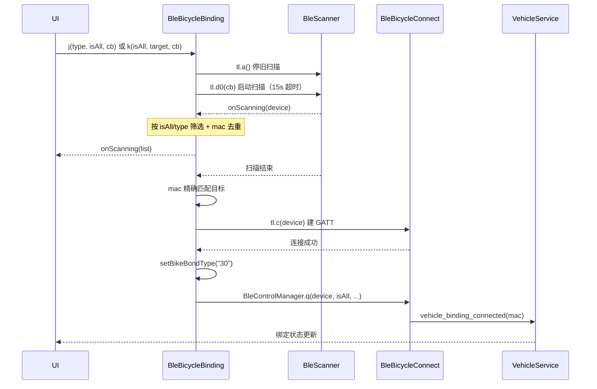

# 车辆绑定

车辆绑定（`BleBicycleBinding`）是把车辆 MAC 与当前账号关联起来的前置流程。
依据 `temp_smali/com/yadea/blecontrol/connect/a.smali`（`BleBicycleBinding.kt`）及其
内部类 `a$a`~`a$f`、`temp_smali/com/yadea/blecontrol/connect/i.smali`、
`temp_smali/com/yadea/blecontrol/data/BleBicycleCommandManager.smali` 的逐行核对。

## 1. 三个入口方法

`BleBicycleBinding` 有三个对外方法，语义不同：

| 方法 | 签名 | 用途 |
| --- | --- | --- |
| `j` | `(type: Int, isAll: Boolean, callback: li?)` | 扫描可绑定设备列表 |
| `k` | `(isAll: Boolean, target: BleDevice, callback: ki?)` | 扫描并绑定指定设备 |
| `o` | `(target: BleDevice, callback: dj?)` | 扫描绑定（另一套回调） |

内部状态字段：

| 字段 | 含义 |
| --- | --- |
| `a` | 停止扫描标志（`q()` 置 true，`p()` 置 false） |
| `b` | `scanBinding:` 日志用的辅助标志 |
| `c` | 「全量扫描」标志（对应 `isAll`） |

## 2. 扫描与筛选

### 2.1 扫描参数

`a.j` 使用 `no$a` 构造扫描规则：

```text
timeout = 0x3a98 = 15000 ms
```

与自行车主路径（`BleBicycleConnect.I`）一致。扫描前先 `tl.a()` 停掉旧扫描，
再 `tl.d0(callback)` 启动。

**UUID、设备名、MAC、模糊匹配等字段均未设置**，保持默认值。

### 2.2 筛选条件（`a$a.b`）

去重规则：结果按 `mac` 去重（遍历已收集列表，`mac` 相同则丢弃）。

`isAll == true` 时：

```text
设备名以 "YD" 开头
  或 isScooter()
  或 isBox()
→ 接受；否则丢弃
```

`isAll == false` 时：

```text
type == 2  → 只接受 isBox()
type == 0  → 要求 bleProtocolVersionName != 0
             且 parkingStatus 满足 0 <= parkingStatus < 2
其他        → 接受
```

> `parkingStatus` 的取值含义见 [ttpinfo-fields.md](./ttpinfo-fields.md)：
> `0 = 已锁`，`1 = 未锁`。绑定扫描要求车辆处于这两种状态之一。

### 2.3 扫描绑定（`a.k` / `a.o`）

`a.k`：

```text
a = false
callback?.start()
tl.a()                       // 停旧扫描
tl.d0(a$b)                   // 启动扫描
```

`a$b.b()` 只接受 `device.mac == target.mac`，命中后停扫描并回调 `ki.b(device)`。
扫描结束时 `a$b.d()` 再检查目标，必要时发起连接。

`a.o`（`scanBinding`）：

```text
a$f.a()  → 置"扫描中"标志
a$f.b()  → mac 精确匹配，命中后记录
```

日志格式：`"scanBinding:$a.$b"` 与 `"onScanning 发现:$device"`。

## 3. 连接与配对

扫描命中后进入连接阶段：

| 回调 | 动作 |
| --- | --- |
| `a$c` | `tl.c(device, callback)` 建立 GATT |
| `a$c.d()` | 连接成功 → `a.n(...)` 进入配对 |
| `a$c.c()` | 连接失败 → `ki.f(false)` |
| `a$c.f()` | 连接开始 → `ki.a()` |

配对（`a.n`）：

```text
BleControlManager.n("30")                // 设置 bondType = "30"
BleControlManager.q(device, isAll=true, null, null, a$e)
```

`a.l` / `a.m` 是另一组连接包装：

| 方法 | 底层调用 |
| --- | --- |
| `a.l` | `tl.c(device, a$c)` 直接建 GATT |
| `a.m` | `BleControlManager.d(device, a$d)` |

## 4. bondType 映射（关键）

`BleBicycleCommandManager.setBikeBondType(String)` 把外部的 **2 位状态码**
转成内部两个字段：

| 外部码 | `bikeBondType` | `bikePairBondType` | 备注 |
| --- | --- | --- | --- |
| `"00"` | `"000"` | `"0000"` | 未绑定 |
| `"10"` | `"001"` | `"0001"` | — |
| `"20"` | `"010"` | `"0010"` | — |
| `"30"` | `"010"` | `"0011"` | **配对时使用**（`a.n` 传入） |
| `"40"` | `"100"` | `"0100"` | — |
| 其他 | `"111"` | `"1111"` | 默认 |

> 注意 `"20"` 与 `"30"` 的 `bikeBondType` **都映射为 `"010"`**，
> 只有 `bikePairBondType` 不同（`"0010"` vs `"0011"`）。

构造器默认值：`bikeBondType = "111"`、`bikePairBondType = "1111"`、`appType = "000"`、`appPairType = "1111"`。

### 4.1 `appType` / `appPairType` 同样由映射表驱动

`setAppType(String)` 是 `setBikeBondType` 的**对偶函数**，一次写入两个字段：

| 外部码 | `appType` | `appPairType` |
| --- | --- | --- |
| `"00"` | `"000"` | `"0000"` |
| `"01"` | `"001"` | `"0001"` |
| `"10"` | `"010"` | `"0010"` |
| `"11"` | `"011"` | `"0011"` |
| `"12"` | `"100"` | `"0100"` |
| `"13"` | `"101"` | `"0101"` |
| 其他 | `"111"` | `"0000"` |

> 注意默认分支：`appType` 是 `"111"` 而 `appPairType` 是 `"0000"`（不是 `"1111"`）。
> 这与 `setBikeBondType` 的默认分支（`"111"` / `"1111"`）**不一致**。

#### 调用链

```text
BaseApplication.c() / e()
  → tl.J(app, "00", AppType.APP_TYPE_SMARTMOTO, isDebug)
      → tl.K(app, "00", isDebug)
          → BleControlManager.N(context, "00", isDebug)
              ├─ S0(context) → PackageInfo.versionName
              │   → 按 "." 切分取前两段 → "%02x" 格式化 → setAppVersion()
              ├─ D("00")
              │   ├─ wi.L0("00")        // 存入 wi.h
              │   └─ setAppType("00")
              └─ ...
```

> [!IMPORTANT]
> **`appType` 的入参在 `BaseApplication` 中硬编码为 `"00"`。**
> 两处调用（`c()` 与 `e()`）都传字面量 `"00"`。
>
> 因此实际运行时：
> - `appType = "000"`
> - `appPairType = "0000"`
>
> 而不是构造器的默认 `"1111"`。但注意 `"00"` 是**外部码**，不是内部值。

### 4.2 二进制串转十六进制

`BleBicycleCommandManager.binaryString2hexString(String)` 的完整逻辑（行 285）：

```text
binaryString2hexString(s):
    if (s == null || s.isEmpty() || s.length % 8 != 0) return null   // ← 必须是 8 的倍数

    sb = ""
    for (i = 0; i < s.length; i += 4):
        v = 0
        for (j = 0; j < 4; j++):
            v += parseInt(s[i+j]) shl (3 - j)      // 高位在前
        sb += Integer.toHexString(v)                // ← 不补零，长度可变
    return sb
```

> [!IMPORTANT]
> **输入长度必须是 8 的倍数，否则返回 `null`。**
> 因此调用方靠**拼接**凑足 8 位：
>
> | 调用点 | 拼接 | 总位数 |
> | --- | --- | ---: |
> | `generateBlePairCommand` | `bikePairBondType`(4) + `appPairType`(4) | 8 |
> | `generateBleBondCommand` | `"11"`(2) + `bikeBondType`(3) + `appType`(3) | 8 |
>
> 注意 `bikeBondType` 前会**固定拼 `"11"`**。

**`toHexString` 不补零**，所以结果长度可变：

| 输入（8 位二进制） | 值 | 输出 |
| --- | ---: | --- |
| `"00001111"` | 15 | `"f"` |
| `"00111111"` | 63 | `"3f"` |
| `"00000000"` | 0 | `"0"` |

> [!CAUTION]
> 这是**与 `decInt2hexString` 不同**的第三个 hex 转换函数，规则是：
> - 输入必须 8 的倍数
> - 每 4 位转 1 个 hex 字符
> - **不补零、不转大写**

## 5. 绑定状态与账号关联

`VehicleService` 的 `category` 分派中有三个与绑定相关的项：

| category | 数据 | 行为 |
| --- | --- | --- |
| `vehicle_binding_connected` | `mac` | 状态/绑定连接处理 |
| `vehicle_unpair` | `mac` | 解绑 |
| `vehicle_bicycle_connect` | `mac` + `isActiveTrigger` | 延迟请求定位权限后连接（`"10"` / `"20"` 区分主被动） |

`vehicle_binding_connected` 的构造（`VehicleService$a`）：

```kotlin
mapOf(
    "category" to "vehicle_binding_connected",
    "data" to mac,
)
→ VehicleService.I(map)
```

车辆绑定是**账号维度**的：扫描绑定时 `ExtendedParamsEntity` 携带
`vin` / `userId` / `mac` / `isAuthToken` / `connectType`，
配对流程会据此获取 token（见 [handshake.md](./handshake.md)）。

## 6. 绑定流程时序



## 7. 跨平台边界

| 能力 | 位置 |
| --- | --- |
| `bondType` 映射、`binaryString2hexString` | `commonMain`（纯函数） |
| 筛选条件（`YD` 前缀 / `isScooter` / `isBox` / `parkingStatus`） | `commonMain`（纯函数） |
| 绑定状态机（`IDLE → SCANNING → FOUND → CONNECTING → PAIRING → BOUND`） | `commonMain` |
| 扫描、GATT、配对 | `androidMain` |
| 绑定结果落库（账号关联） | 见 [auth.md](./auth.md) 的存储约定 |

建议把筛选与 `bondType` 映射做成纯函数并单测，因为它们是最容易出错、
又最容易验证的部分。

```kotlin
/** setBikeBondType 的等价实现 */
fun bikeBondType(external: String): Pair<String, String> = when (external) {
    "00" -> "000" to "0000"
    "10" -> "001" to "0001"
    "20" -> "010" to "0010"
    "30" -> "010" to "0011"
    "40" -> "100" to "0100"
    else -> "111" to "1111"
}

/** a$a.b 的筛选条件 */
fun shouldAccept(
    device: BindableDevice,
    isAll: Boolean,
    type: Int,
): Boolean = if (isAll) {
    device.name?.startsWith("YD") == true || device.isScooter || device.isBox
} else when (type) {
    2 -> device.isBox
    0 -> device.bleProtocolVersionName != 0 &&
         device.parkingStatus in 0 until 2
    else -> true
}
```

## 8. 待确认

| 项 | 说明 |
| --- | --- |
| 绑定结果是否写入后端 | smali 中未见明确的绑定接口路径 |
| `appPairType` 的取值来源 | ✅ 已确认：由 `setAppType` 写入，外部码硬编码为 `"00"` |
| `vehicle_unpair` 的底层动作 | 是否为纯本地解绑 |
| 解绑后是否清除 token 缓存 | 见 [handshake.md](./handshake.md) 的 `ud5` |
| `type` 的完整取值枚举 | 目前只确认 `0`（自行车）与 `2`（Box） |
