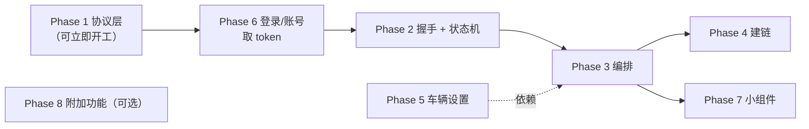

# 登录/账号体系 smali 事实（逐行确认）

**已确定账号体系必须实现**（车辆验证连接信息依赖它），因此 Phase 6 是 Phase 2 的硬前置。
本文收录 `k05.smali`、`tb0.smali`、`sb0.smali`、`t46.smali`、`o13.smali`、`f84.smali`
的逐行核对结果，可直接转成 Kotlin 实现。

---

## 1. 11 个接口 ✅ 全部逐字段确认

`k05.smali` 中 `Lo71;->K(path)` 调用点与业务字段：

| # | 方法 | 路径 | 业务字段（HashMap 顺序） | 响应回调 |
| ---: | --- | --- | --- | --- |
| 1 | `p(account, password, type)` | `user/loginByPassword` | `account`, `password`, `accountType`=type, `appType`=1, `oppoPushId`, `registrationId` | `k05$e` → 字段 `a` |
| 2 | `r(mobile, code, ...)` | `user/loginBySms` | `mobile`, `code`, `registrationId` | `k05$c` → 字段 `a` |
| 3 | `k(mobile, type, action0)` | `user/sendCode` | `mobile`, `sendCode`=type, `appType`=1, `registrationId` | `k05$g` → 字段 `c` |
| 4 | `j(email, type, action0)` | `user/sendCodeByEmail` | `email`, `sendCode`=type, `appType`=1, `registrationId` | `k05$h` → 字段 `d` |
| 5 | `o(phone, type, isBand, action1)` | `user/sendCode/third-mobile` | `mobile`, `sendCode`=8, `thirdLoginType`=type, `verifyBind`=isBand, `appName`="YADEA", `yadeaAppType`="1"(仅 type==0), `registrationId` | — |
| 6 | `q(email, code, password)` | `user/registerByEmail` | `email`, `code`, `appType`=1, `password`, `registrationId` | — |
| 7 | `l(password)` | `user/setPasswordByUserId` | `password` | `k05$k` |
| 8 | `n(account, code, password, type)` | `user/updatePasswordByCode` | `account`, `code`, `password`, `appType`=1, `accountType`=type | — |
| 9 | `m(account, code, type, action0)` | `user/bindOrChangeEmail` | `email`(=account), `code`, `appType`=1, `type` | `k05$j` → 字段 `f` |
| 10 | `s(newPhone, code, type, action0)` | `user/bindOrChangeMobile` | `mobile`, `code`, `appType`=1, `type` | `k05$d` → 字段 `g` |
| 11 | `i(mobileNo, smsCode, bean)` | `user/third-auth/openid-mobile/bind` | 见下 | `k05$a` → 字段 `i` |

`i()` 的字段（**条件性写入**，非空才放）：

```text
code          ← bean.code          （非空才放）
mobile        ← mobileNo
msgCode       ← smsCode
thirdLoginType← bean.type
appNameId     = 1
sendCode      = 8
openid        ← bean.openID        （非空才放）
thirdNickname ← bean.nickName      （非空才放）
figureurlQq   ← bean.qqUrl         （非空才放）
registrationId
yadeaAppType  = "1"                （仅当 bean.type == 0）
```

> [!NOTE]
> `thirdLoginType`、`appNameId=1`、`sendCode=8` 都是**整型**（`Integer.valueOf`），
> 而 `appType`/`yadeaAppType`/`appName` 是**字符串**。类型不能混。

---

## 2. `_gateway` 与请求体形态 ✅

`f84.smali`（`ParamGenerationUtil`）：

```kotlin
// f84.a(map)：注入 _gateway
fun a(map: Map<String, Any?>?): Map<String, Any?> {
    val m = map ?: HashMap()
    m["_gateway"] = P4F.b          // 静态字符串
    return m
}
// f84.b(map) = Gson().toJson(a(map))
// f84.c(map) = Gson().toJson(map)   // 不注入
```

`_gateway` 取值（`p4$f.b` 类初始化）：

```text
if (p4.o.endsWith("/api/app/") && !p4.o.contains("8076")) "True"
else "False"
```

`BaseBodyRequest.g0(json)` 分支：

| 条件 | 最终 API | Wire body |
| --- | --- | --- |
| `_gateway != "False"` | `s4.h`：`@FormUrlEncoded @POST` | 先 form，后被拦截器改为**只剩** `gatewaySign` + `gatewayTimestamp` |
| `_gateway == "False"` | `s4.j`：JSON POST | JSON 原文 |
| JSON 解析异常 | 回退 `s4.j` | JSON 原文 |

---

## 3. 网关签名 ✅ 完整算法

`tb0.smali`（`CommonParamsInterceptor`，构造参数 `mAppSecret` = `"cIDJ9f05d1604703"`）：

```text
d(TreeMap dynamicMap):
1. 若 !containsKey("_gateway") || get("_gateway") == "False" → 原样返回

2. 遍历所有 key：
     若 value 非空且 contains("%") → URLDecoder.decode(value, "utf-8") 后写回

3. timestamp = new Date().getTime() + s85.i().o("mistiming")
   （mistiming 缺失默认 -1）

4. json = GsonUtils.toJson(dynamicMap)

5. 规范化（针对服务端签名一致性，必须复刻）：
   5.1 if (json contains \")      → replaceAll("\\\\\"", "\"")
   5.2 if (json contains "essay") → 特殊分段重组（见下）
   5.3 if (!contains "essay" && contains "{\"") →
         replaceAll("\"\\{", "\\{") 且 replaceAll("\\}\"", "\\}")
   5.4 if (contains "\"[") → replaceAll("\"\\[", "\\[") 且 replaceAll("\\]\"", "\\]")

6. plaintext = "gatewayTimestamp=" + timestamp + "&json=" + json

7. dynamicMap.clear()                       // ← 清空！

8. dynamicMap["gatewaySign"] =
       URLEncoder.encode(AesUtils.encrypt(key, plaintext), "utf-8")

9. dynamicMap["gatewayTimestamp"] = timestamp.toString()
```

`AesUtils.encrypt`：16 字节 UTF-8 key、`AES/ECB/PKCS5Padding`、Base64 `flag=0`。

> [!CAUTION]
> **第 5 步的 JSON 规范化是签名一致性的关键。** 若省略，
> 服务端校验失败且**不会有明确错误提示**。
> 其中 `essay` 分支是 `substring` 分段重组（`indexOf("\"essay\":")` +
> `indexOf(",\"")` + `indexOf("\"}")`），逻辑较重，移植时建议先按 5.1/5.3/5.4 实现，
> `essay` 分支留 TODO 并加注释（该字段只出现在少数商城接口，登录链路不涉及）。

> [!IMPORTANT]
> **`dynamicMap.clear()` 后只写回两个字段**——业务字段全部消失。
> 因此 `_gateway=True` 时**最终 wire body 只有** `gatewaySign` 和 `gatewayTimestamp`。
> 这与 docs 的描述一致，且已确认。

### 3.1 `mistiming` 来源

`s85.i().o("mistiming")`：SharedPreferences `long`，缺失默认 `-1`。
由 `405` 响应的 `_token_time_invalid` 事件更新。

---

## 4. 公共请求头 ✅ 全量确认

`sb0.smali`（`CommonHeadInterceptor`）：

| Header | 值 | 条件 |
| --- | --- | --- |
| `Authorization` | `"Bearer " + token` | token 非空；**若已以 `Bearer` 开头则不重复加** |
| `req-id` | `UUID.randomUUID().toString()` | 总是 |
| `request-agent` | `"2"` | 总是 |
| `deviceId` | MMKV `loginId`；为空则生成 UUID 并写回 | 总是 |
| `os` | `"android"` | 总是 |
| `app-version` | `u74.c(context)` | 总是 |
| `bike-series-code` | MMKV 车辆系列码，空则 `CarType.c.key` | 总是 |
| `app-name` | `"YADEA"` 或 `"FACTORY"`（比较 `common_yadea_name` 与 `app_name` 资源） | 总是 |
| `app-version-num` | `u74.b(context)` | 总是 |
| `app-market` | `u74.d(context)` | 总是 |
| `app-version-type` | `"2"` 或 `"1"`（`v32.a` 开关） | 总是 |
| `device-brand` | `sz5.a()` | 总是 |
| `phone-model` | `sz5.b()` | 总是 |
| `language` | `"zh_CN"` | 总是 |
| `push-operator` | `"2"` | 总是 |

特例：URL 含 `maps.googleapis.com` → **直接放行，不加任何头**。

`bike-series-code` 在 smali 里出现了一段 `StringBuilder("bike-series-code:")` 但结果**未被使用**
（只做了 `header("bike-series-code", value)`），属死代码。

另外 `k05.p`/`k05.r` 额外用 `tf.x("device-brand", ...)` 单独设置了 header。

---

## 5. Token 失效判定 ✅

`t46.smali`（`TokenErrorInterceptor.a(response, bodyString)`）：

```text
1. bodyString 非空
2. decoded = URLDecoder.decode(bodyString, "utf-8")
3. plain   = AesUtils.decrypt("cIDJ9f05d1604703", decoded)
4. obj     = JSONObject(plain)
5. code    = obj.optString("code")

6. code == "101000" || code == "100995" → post "_token_invalid"（carries code）
   code == "405"                        → post "_token_time_invalid"（carries obj.getString("timestamp")）
   其他                                 → 什么都不做

7. 恒返回 false（不拦截请求）
```

> [!NOTE]
> `t46.a` **总是返回 `false`**，`t46.c(chain, bodyString)` **返回 `null`**。
> 说明它只做「副作用」（发事件），不改写响应。
> 且 `code` 用 `optString` 读，再与**字符串**比较——不是整型。

---

## 6. 登录态落盘 ✅

`o13.smali`（`LoginStateUtils`）：

```kotlin
fun a(bean: UserInfoBean?): Boolean {
    if (bean == null) return false
    b(bean, isLoginSuccess = true)
    return true
}

fun b(bean: UserInfoBean, isLoginSuccess: Boolean) {
    zm3.h2(bean.token)        // MMKV key "usr_token"
    zm3.i2(bean)              // MMKV key "usr_info"（内部先重算 authKey）
    if (!isLoginSuccess) return
    LiveDataBus["_community_login"].setValue(bean)
    if (!bean.mobile.isNullOrEmpty()) AnalysysAgent.alias(ctx, bean.mobile)
    ToastUtils.showShort(R.string.login_login_succeed)
}
```

`zm3.i2(bean)` 内部：

```text
bean.authKey = m63.b(bean.mobile)      // MD5 小写 hex（逐 char 低 8 位变体）
MmkvHelper.putObject("usr_info", bean) // Gson 序列化
```

`MmkvHelper.putObject/getObject` 用 `Gson`，因此 `usr_token` 存的是
**JSON 字符串字面量**（带双引号），不是裸 token。

> [!IMPORTANT]
> **`@Login` 注解的"登录后重放原调用"未在 smali 中找到实现**（docs 已声明）。
> `_community_login` 是 LiveData，不是 EventBus（注意与 `_token_invalid` 不同）。

---

## 7. 响应成功/失败判定 ✅

```text
ApiResult<T> = { success: Boolean, code: Int, msg: String, data: T }
判定 = ApiResultFunc 解析 → HandleFuc 调 ApiException.d(apiResult) = apiResult.isOk()
  success == true  → 传 data
  success == false → throw ServerException(code, msg) → 转 ApiException
```

**不是** HTTP 状态码，**也不是** 业务 `code == 200`。

失败时 `k05` 各回调读的是 `ApiException.getMessage()`（不是 `displayMessage`）。

---

## 8. Disposable 覆盖缺陷 ✅

`k05` 有 `a`–`j` 共 **10 个** `Disposable` 字段，`cancel()` 逐个 cancel。

**`loginByPassword`（`p`）与 `loginBySms`（`r`）都用字段 `a`** ——
后发起的请求覆盖前一个引用，前一个**无法再被 cancel**。
这是原实现缺陷，移植时可修复（各自独立字段），但需知晓。

---

## 9. 对实施计划的影响

### 9.1 Phase 6 升格为硬前置



### 9.2 Phase 6 的依赖清单

| 能力 | 建议方案 |
| --- | --- |
| HTTP 客户端 | Ktor（各平台 engine），或 `expect` 轻量抽象 |
| AES/ECB/PKCS5 | KMP 无内置；需 `expect`（Android: `javax.crypto`；JS: WebCrypto；JVM: `javax.crypto`） |
| MD5 | 同上，`expect` |
| Base64 | `kotlin.io.encoding.Base64`（Kotlin 1.8+ 标准库，跨平台可用）✅ |
| URLDecoder/Encoder | 需 `expect`（Java 的 `URLDecoder` 与 JS 的 `decodeURIComponent` 行为不同） |
| Gson 兼容 | 用 `kotlinx.serialization` + 自定义 `Map` 序列化，**但 JSON 字段顺序会影响签名** |

> [!CAUTION]
> **签名涉及 JSON 字符串本身，字段顺序敏感。**
> `GsonUtils.toJson(TreeMap)` —— `TreeMap` 是**按 key 字典序**的，所以顺序是确定的。
> 用 `kotlinx.serialization` 序列化 `Map` 时**必须保证同样的字典序**，
> 否则 `gatewaySign` 与服务端不一致。这是最容易踩的坑。

### 9.3 建议的实现顺序（Phase 6 内部）

1. `AuthValidation.kt` — 正则校验（纯逻辑，可立即单测）
2. `GatewaySigner.kt` — 签名（AES 与 JSON 规范化，可用固定向量单测）
3. `AuthModels.kt` — `UserInfoBean` / `OtherLoginBean`
4. `AuthApi.kt` — 11 个接口 + 拦截器链
5. `AuthSession.kt` — token 生命周期
6. `AuthScreen.kt` — UI（遵守 `App*` 组件规范）

> [!TIP]
> 第 1、2 步**不依赖网络也不需要真机**，可以先做并写对拍单测。
> 特别是第 2 步，建议用「固定 JSON + 固定时间戳 → 期望 gatewaySign」
> 构造向量，因为签名错了服务端只会给模糊报错。

---

## 10. 仍未确认

| 项 | 影响 |
| --- | --- |
| `AesUtils.encrypt` 的 Base64 `flag=0` 具体形态（是否有换行） | 影响签名串 |
| `GsonUtils.toJson` 的转义策略（是否 `disableHtmlEscaping`） | 影响签名串 |
| `p4.o`（环境 URL）的来源与取值 | 决定 `_gateway` 为 True 还是 False |
| `mistiming` 的更新时机与初始值 | 影响时间戳 |
| 微信/QQ 第三方登录的 SDK 接入 | 需第三方 AppId |
| `zm3.z0()` 读 token 时对 `null` 的处理 | 已确认：`null` → `""` |
