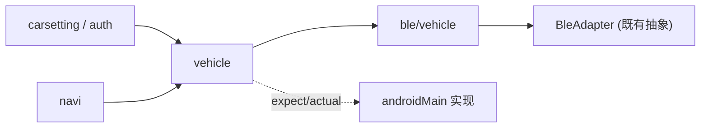
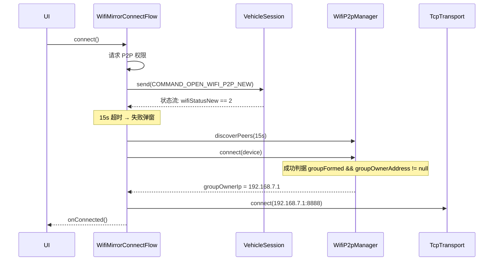

# toupin × YadeaHook/docs 实现规格

本文是 [yadeahook-docs-integration-plan.artifact.md](file:///C:/Users/DozenOregano696/AppData/Local/Google/AndroidStudio2026.2.1/projects/toupin.4c1ef0d2/.artifacts/b8e65a89-faca-48bd-bab3-80ebc22cbb4c/yadeahook-docs-integration-plan.artifact.md)
的展开版：把每个阶段「具体怎么写」落到文件、类型签名、算法和常量表。

> [!NOTE]
> 本文只描述**怎么实现**，不含完整实现代码。
> 常量、UUID、字段偏移的**字节码级证据**见
> [smali-confirmed-facts.artifact.md](file:///C:/Users/DozenOregano696/AppData/Local/Google/AndroidStudio2026.2.1/projects/toupin.4c1ef0d2/.artifacts/b8e65a89-faca-48bd-bab3-80ebc22cbb4c/smali-confirmed-facts.artifact.md)，
> 本文只保留仍标 ⚠️、需实车验证的部分。

> [!IMPORTANT]
> **实施顺序已修正**（原计划有误）：
> 握手帧需要 token，但 `isAuthToken == false` 时可完全绕过。
> 因此 **Phase 1 可立即开工**，Phase 6 是否为前置取决于目标连接路径。

---

## 1. 模块与依赖布局

新增代码集中在 `shared/commonMain/kotlin/top/ghhccghk/yadea/` 下的新包，**不修改**现有 `ble/`、`protocol/`、`mirror/`、`network/`、`wifi/`。

```text
shared/src/commonMain/kotlin/top/ghhccghk/yadea/
├── ble/vehicle/                     # Phase 1-2：车辆 BLE 纯逻辑
│   ├── VehicleBleConstants.kt       # UUID / 超时 / MTU / 端口常量
│   ├── VehicleFrame.kt              # 5944…4B4A 帧构建与解析
│   ├── ScooterFrame.kt              # CRC16-XMODEM + XOR(i+10)
│   ├── Checksums.kt                 # SUM8 / CRC16-XMODEM / CRC32-MPEG2
│   ├── VehicleCommands.kt           # CommandBean + t() 映射 + 命令表
│   ├── VehicleNotify.kt             # 通知分派 + 协议版本判定
│   ├── VehicleStatus.kt             # TtpInfo / PanelInfo / FaultInfo / ScooterStatusInfo
│   ├── VehicleConnectionState.kt    # 状态枚举 + disconnectType
│   ├── VehicleConnectFlow.kt        # 状态机（纯函数转移）
│   └── InitTaskQueue.kt             # 5 项初始化任务队列
├── vehicle/                         # Phase 3：编排抽象
│   ├── VehicleSession.kt            # 对外会话接口（状态流 + 命令入口）
│   └── VehicleSessionFactory.kt     # expect fun createVehicleSession()
├── navi/                            # Phase 4：建链编排
│   ├── NaviConnectType.kt           # TFT_IMG/TFT/YILIAN/WIFI
│   └── WifiMirrorConnectFlow.kt     # BLE 开门 → 等状态 → P2P → TCP
├── carsetting/                      # Phase 5：车辆设置
│   ├── SettingModels.kt             # SettingBaseModuleData 族
│   ├── SettingClassification.kt     # 9 分类
│   ├── SettingRegistry.kt           # 6 个主列表 Registry
│   ├── SettingWriteFlow.kt          # 防抖 + 乐观切换 + 回滚
│   └── SettingStatusCheck.kt        # checkSettingStatus + 轮询
└── auth/                            # Phase 6：登录
    ├── AuthModels.kt                # UserInfoBean / OtherLoginBean
    ├── GatewaySigner.kt             # AES 网关签名
    ├── AuthApi.kt                   # 11 个接口定义
    ├── AuthSession.kt               # token 生命周期
    └── AuthValidation.kt            # 正则校验

shared/src/androidMain/kotlin/top/ghhccghk/yadea/
├── ble/vehicle/AndroidVehicleTransport.kt   # GATT 实际读写
├── vehicle/VehicleSession.android.kt        # 编排实现
├── vehicle/VehicleForegroundService.kt      # connectedDevice 前台服务
└── auth/HttpEngine.android.kt               # Ktor OkHttp engine

androidApp/src/main/kotlin/top/ghhccghk/yadea/widget/
├── VehicleWidgetProvider.kt         # GlanceAppWidget + Receiver
├── VehicleWidgetState.kt            # 小组件状态
└── VehicleWidgetActions.kt          # ActionCallback → 前台服务
```

依赖方向（严格单向，`commonMain` 不得反向依赖）：



---

## 2. Phase 1 — 车辆 BLE 协议层

### 2.1 常量：`VehicleBleConstants.kt`

⚠️ 与现有 [BleProtocol.kt](file:///F:/android%20app%20code/toupin/shared/src/commonMain/kotlin/top/ghhccghk/yadea/ble/BleProtocol.kt) 的 `7e4000xx` **是两套**，必须独立对象。

| 常量 | 值 | 用途 |
| --- | --- | --- |
| `SERVICE_MAIN` | `0000b360-d6d8-c7ec-bdf0-eab1bfc6bcbc` | 车辆主服务 |
| `CHAR_MAIN` | `0000b362-d6d8-c7ec-bdf0-eab1bfc6bcbc` | 主特征（**NOTIFY + WRITE 双属性**） |
| `SERVICE_DEVICE_INFO` | `0000180a-0000-1000-8000-00805f9b34fb` | 设备信息 |
| `CHAR_MANUFACTURER` | `00002a29-...` | 制造商名 |
| `CHAR_FW_HW_VERSION` | `00002a26-...` | ⚠️ 固件与硬件任务**都读它** |
| `CHAR_SOFTWARE_REV` | `00002a28-...` | 软件版本 |
| `CHAR_CCCD` | `00002902-0000-1000-8000-00805f9b34fb` | 标准 CCCD |
| `SERVICE_NOTIFY_V1` | `e7810bd2-73ae-499d-8c15-faa9aef0c3f2` | 协议版本 ==1 的通知服务 |
| `CHAR_NOTIFY_ENABLE_V1` | `bef8e820-9c21-4c9e-b632-bd58c1009f9f` | 启用状态通知 |
| `CHAR_STATUS_QUERY_V1` | `bef8e821-9c21-4c9e-b632-bd58c1009f9f` | 整车状态查询 |
| `SERVICE_NOTIFY_OTHER` | `e7810b82-73ae-499d-8c15-faa9aef0c3f2` | 其他版本 |
| `CHAR_NOTIFY_ENABLE_OTHER` | `bef8e7db-9c21-4c9e-b632-bd58c1009f9f` | — |
| `CHAR_STATUS_QUERY_OTHER` | `bef8e7da-9c21-4c9e-b632-bd58c1009f9f` | — |
| `SERVICE_SCOOTER` | `6e400001-b5a3-f393-e0a9-e50e24dcca9e` | 滑板车服务 |
| `CHAR_SCOOTER_WRITE` | `6e400002-b5a3-f393-e0a9-e50e24dcca9e` | 滑板车写 |

参数表：

| 项 | 值 | 语义 |
| --- | --- | --- |
| `SCAN_TIMEOUT_MS` | `15_000L` | 扫描超时 |
| `GATT_CONNECT_TIMEOUT_MS` | `20_000L` | GATT 连接超时（独立计时器） |
| `WATCHDOG_TIMEOUT_MS` | `15_000L` | 扫描/连接看门狗 |
| `WATCHDOG_TICK_MS` | `1_000L` | 看门狗 tick |
| `GATT_OP_TIMEOUT_MS` | `5_000L` | 单次 GATT 操作 |
| `POST_CONNECT_DELAY_MS` | `500L` | 连上后延迟再 discover |
| `RECONNECT_DELAY_MS` | `5_000L` | 重连间隔 |
| `MAX_RECONNECT` | `1` | 最多 1 次 |
| `TASK_MAX_RETRIES` | `2` | 即 3 次尝试 |
| `TASK_RETRY_INTERVAL_MS` | `200L` | 重试间隔 |
| `TASK_SUCCESS_INTERVAL_MS` | `50L` | 成功后续接间隔 |
| `REQUESTED_MTU` | `512` | 仅配对路径请求 |
| `MTU_MIN` / `MTU_MAX` | `24` / `512` | 合法范围 |
| `NOTIFY_THROTTLE_MS` | `100L` | 通知节流阈值 |
| `NOTIFY_DELAY_MS` | `110L` | 节流延迟 |
| `STATUS_REPORT_THROTTLE_MS` | `2_000L` | **严格大于** |
| `ERROR_133` | `0x85` | 需 `refresh()` 清缓存 |

### 2.2 帧编解码：`VehicleFrame.kt`

```kotlin
// 车辆控制帧：5944 + ORDER_ID + LEN + PAYLOAD + SUM8 + 4B4A
// 字节级证据：BleBicycleCommandManager.smali L5695-5770
object VehicleFrame {
    const val ORDER_HEAD = "5944"        // "YD"
    const val ORDER_TAIL = "4B4A"        // "KJ"
    const val ORDER_ID = "3E"            // 普通控制/查询
    const val EXTERNAL_ORDER_ID = "3A"   // 外部命令
    const val ORDER_ID_3B = "3B"         // 3B 专用
    const val DEFAULT_LENGTH = "1E"

    fun build(orderId: String, payload: ByteArray): ByteArray
    fun parse(data: ByteArray): VehicleFrameData?   // 含 SUM8 校验结果
}
```

算法（**已逐行确认**）：

```text
frame = "5944" + ORDER_ID + decInt2hexString(payload.size)
      + payload + CHECK + "4B4A"
CHECK = getCheckResult(ORDER_ID + decInt2hexString(len) + payload)
整体 toUpperCase(Locale.ROOT)
```

> [!CAUTION]
> **`5944/4B4A` 被两套协议共用，但结构完全不同：**
> - 车辆帧：协议 ID `3E`/`3A`/`3B`，长度是**变长 hex 字符串**，校验覆盖 `ORDER_ID+LEN+PAYLOAD`
> - 投屏帧（[YadeaProtocol.kt](file:///F:/android%20app%20code/toupin/shared/src/commonMain/kotlin/top/ghhccghk/yadea/protocol/YadeaProtocol.kt)）：协议 ID `3C`，长度是 **BE32 定长 4 字节**，校验覆盖 `3C+INNER_LEN+INNER_PACKET`
>
> **两者必须各留一套构建函数**，禁止复用。
>
> 另外 `5944FFF0/FFF1/FFF2` 是**部件通道 UUID**，不是帧头。三者字符串前缀相同纯属巧合。

两个易错点（**已确认**）：

```text
长度字段：Integer.toHexString(len) 原样，不补零 → len=1 得到 "1"
校验字段：仅当长度为 1 时才补 "0" → 补齐到 2 位
```

```kotlin
// 追加 FF 填充，不是分包序号
fun getIncreaseByteHexStr(): String
// n 钳制 <= 10；ORDER_LENGTH = toHexString(0x1E + n)
fun increaseControlByte(n: Int)
```

### 2.3 校验算法：`Checksums.kt`

```kotlin
object Checksums {
    fun sum8(bytes: ByteArray): Int                       // 8 位算术和
    fun crc16Xmodem(data: ByteArray): Int                 // poly 0x1021, init 0x0000, 不反转, final 0
    fun crc16XmodemHex(data: ByteArray): String           // hex 奇数补 0；长度==2 前补 "00"
    fun crc32Mpeg2(data: ByteArray): Long                 // poly 0x04C11DB7, init 0xFFFFFFFF, MSB-first
    fun crc32Mpeg2Hex(data: ByteArray): String            // 奇数补 0；长度==6 再补 "00"
    fun scooterEncrypt(frame: ByteArray): ByteArray       // out[i] = frame[i] xor ((i + 10) and 0xFF)
}
```

滑板车帧组装顺序（**XOR 覆盖 CRC 字节**）：

```text
out = COMMAND_BYTES + CRC16_HIGH + CRC16_LOW
getData()        → 再对整帧 scooterEncrypt()
getDataNoDencry()→ 不做 XOR（查询/OTA 用）
```

### 2.4 命令表：`VehicleCommands.kt`

```kotlin
data class VehicleCommand(
    val commandType: String,          // 自由字符串，不是枚举
    val commandParam: Int = -1,
    val clientId: Int = 1,
    val isPlural: Boolean = false,    // 忙碌时是否允许并发
    val isVoice: Boolean = false,
    val isFromWidget: Boolean = false,
    val isMultiOrder: Boolean = false,
    val orderId: String? = null,
    val commandParams: Map<String, Int> = emptyMap(),
    val commandParamStr: String = "",
)
```

`t()` 映射表（**原地修改同一对象**，仅 `isX1Scooter || isBicycleScooter` 生效）：

| 原始 | 映射后 | param |
| --- | --- | ---: |
| `SCOOTER_GEAR_1..6` | `DRIVING_MODE_SWITCH` | 0..5 |
| `SCOOTER_GEAR_X` | `DRIVING_MODE_SWITCH` | 3 |
| `SCOOTER_ENERGY_RECOVERY_WEAK/MEDIUM/STRONG` | `BRAKE_RECOVER_LEVEL` | 1/2/3 |
| `SCOOTER_CLOSE_CRUISE_CONTROL` | `CRUISE_CONTROL_CLOSE` | 不变 |
| `SCOOTER_OPEN_CRUISE_CONTROL` | `CRUISE_CONTROL_OPEN` | 不变 |
| `SCOOTER_UNLOCK` | `RELEASE_FORTIFY` | 不变 |
| `SCOOTER_LOCK` | `FORTIFY` | 不变 |

已知 numeric ID：`DRIVING_MODE_SWITCH=0x8F`、`BRAKE_RECOVER_LEVEL=0x3D`、`CRUISE_CONTROL_CLOSE=0x93`、`FORTIFY=3`。

**自行车 8 个经典命令**（**已逐字节确认**，未经 `5944` 包封）：

| 常量 | Hex | 语义 |
| --- | --- | --- |
| `CAR_COMMAND_LOCK` | `07 01 01` | 锁车 |
| `CAR_COMMAND_UNLOCK` | `07 01 02` | 开锁 |
| `CAR_COMMAND_WHISTLE` | `07 01 03` | 寻车（鸣笛） |
| `CAR_COMMAND_ON` | `07 01 04` | 开机 |
| `CAR_COMMAND_CUSHION` | `07 01 09` | 坐垫 |
| `CAR_COMMAND_ODO_RESET` | `07 01 0A` | ODO 清零 |
| `CAR_COMMAND_DETECT` | `07 01 0D` | 检测 |
| `CAR_COMMAND_OFF` | `07 01 0E` | 关机 |

命令 ID 分派：`0x08`→ON、`0x07`→OFF、`0x06`→LOCK、`0x04`→UNLOCK、`0x03`→WHISTLE、
`0x05`→DETECT、`0x31`→ODO_RESET、`0x09`→CUSHION、`0x4C`→氛围灯。

**滑板车 payload**（发送前加 CRC16 + XOR）——完整表见 `ble-control-commands.md` 4.6 节，实现时逐条录入：

```kotlin
object ScooterPayload {
    val BLE_CONNECT          = "5A230202024040"
    val LOCK                 = "5A230202020101"
    val UNLOCK               = "5A230202020001"
    val GEAR_1 / GEAR_2 / GEAR_3 = "5A230505022101" / "…22201" / "…22301"
    val OPEN_CRUISE_CONTROL  = "5A230202020404"
    val CLOSE_CRUISE_CONTROL = "5A230202020004"
    val ENERGY_RECOVERY_WEAK / MEDIUM / STRONG = "5A211A1A0101" / "…0102" / "…0103"
    val FACTORY_RESET        = "5A230303020101"
    // …（共 40+ 条，含 QUERY_* 与固件升级系列）
}
```

> [!WARNING]
> `onControlSuccess` **只代表 GATT 写成功**，不是车辆执行 ACK。
> UI 上不得据此显示"开锁成功"，只能显示"指令已发送"。

### 2.5 通知解析：`VehicleNotify.kt` / `VehicleStatus.kt`

协议版本判定（**顺序敏感**）：

```text
if data.size > 10:
    if data.size == 14 && data[9] == 0x41 && data[10] == 0x05 -> 0xF1 (241)
    elif data[9] < 0xFF && data[10] < 0xFF                     -> 1
    else                                                        -> 0xF1
else:
    -> 0xF1
```

分派（协议版本 1，按 `data[2]`）：

| `data[2]` | 解析为 | 说明 |
| --- | --- | --- |
| `0x2A` / `0x7A` | `TtpInfo` | 完整 |
| `0x29` | `TtpInfo` | 短报文 |
| `0x2B` | `ExternalDeviceTtpInfo` | 外部设备 |
| `0xEA` / `0xE9` | `AlipayNfcInfo` | `0xE9` 额外带 `tagId` |
| `0xB0`–`0xB4` / `0xB8` | `PartsTtpInfo` | IOT/BMS/MCU/ALM/ICM/NFC |
| 以 `0x5A` 开头 | `ScooterStatusInfo` | 滑板车周期报文 |

旧协议（≠1）：hex 按空格拆分，`tokens[0] == "04"` → `tokens[1] == "01"` 为 `PanelInfo`、`"02"` 为 `FaultInfo`。

```kotlin
sealed interface VehicleNotify {
    data class Ttp(val info: TtpInfo, val isShort: Boolean) : VehicleNotify
    data class External(val info: ExternalDeviceTtpInfo) : VehicleNotify
    data class AlipayNfc(val info: AlipayNfcInfo) : VehicleNotify
    data class Parts(val info: PartsTtpInfo) : VehicleNotify
    data class Scooter(val info: ScooterStatusInfo) : VehicleNotify
    data class LegacyPanel(val info: PanelInfo) : VehicleNotify
    data class LegacyFault(val info: FaultInfo) : VehicleNotify
}
```

> [!IMPORTANT]
> **解析逻辑不在 `TtpInfo.smali`**（它只有字段声明，共 2 个方法）。
> 真正的解析器是 `l76.smali`（12724 行）：`l76.z([B)` 完整报文、`l76.y([B)` 短报文。
>
> **字节序已确认：`l76.H`/`l76.e` 是小端（LE），`l76.J` 是大端（BE）——同一报文里混用。**
> 实现时不能统一按一种字节序处理，必须逐字段按原调用选择。
>
> 位域原语已全部确认（见 [smali-confirmed-facts](file:///C:/Users/DozenOregano696/AppData/Local/Google/AndroidStudio2026.2.1/projects/toupin.4c1ef0d2/.artifacts/b8e65a89-faca-48bd-bab3-80ebc22cbb4c/smali-confirmed-facts.artifact.md) 第 2 节）：
> `m`=u8、`C`=3bit、`G`=2bit、`d`=4bit、`c`=5bit，无效值均为"全 1"→ `-1`。
>
> 实现策略：先做已确认 offset 的字段（`parkingStatus`、`onOffStatus`、`currentSpeedValue`、
> `currentOdoValue`、`currentTripValue`、`busbarVoltage`、`busbarCurrent` 等 30+ 个），
> 剩余字段按需增量补齐，避免一次性录入 295 个易错字段。

### 2.5.1 握手/鉴权帧（⚠️ docs 完全未描述，结构已确认）

```text
wi.E0(device, randKey, isFactory, extParams, cb, onFail)
  → token = ud5.r(extParams.userId, device.mac)
  → token 为空时走 NetTokenHelper.d(...) 联网获取
  → 否则 wi.D0 → wi.E

wi.E:
  raw = token + "5944FFFFFFFF" + a + b + P0(randKey, 6, 3) + c + d + "FFFF"
  out = hexDecode(raw).copyOf(0x20)      // 强制 32 字节
  out[31] = XOR(out, 31)                 // 用 XOR 收尾，不是 SUM8
```

> [!CAUTION]
> 握手帧**不是** `5944…4B4A` 帧：它以 `token` 开头、含 `5944FFFFFFFF` 标记、固定 32 字节、
> 用 **XOR 折叠**收尾。两者共用 `5944` 字符串但结构完全不同，必须是两个独立函数。

**鉴权可绕过（关键）**：

```text
NetTokenHelper.d(...):
    if (!extParams.isAuthToken) {   // Boolean?，null 视为 false
        callback.onError(-1, "No authentication is required")
        return
    }
```

`ExtendedParamsEntity(vin, userId, mac, isAuthToken: Boolean?, connectType: ConnectType)`，
`connectType` 默认 `ConnectType.b`。`connectType == c` 跳过 userId 校验，`== d` 跳过 vin 校验。

> [!IMPORTANT]
> `isAuthToken == false` 时**完全跳过 token 获取**，直接进入握手。
> 这是"免登录控车"的开关。若走此路径，**Phase 6 登录不是 Phase 2 的前置**。
>
> 若走鉴权路径，token 存储为 `EncryptedSharedPreferences`，key = `key_vehicle_token_{userId}_{mac}`，
> 真正的密钥字段是 `BleTokenBean.dkInfo`（不是 `token`）。

### 2.6 单测向量（`jvmTest`）

用已确认的字节级事实做对拍，**不依赖真车**：

| 用例 | 输入 | 断言 |
| --- | --- | --- |
| 锁车帧 | `orderId="3E"`, hexPayload `"070101"` | `5944` + `3E` + `03` + `070101` + CHECK + `4B4A` |
| SUM8 | 同上 | `toHexString((0x3E + 3 + 0x07 + 0x01 + 0x01) and 0xFF)` |
| 校验补零 | sum 只有 1 位 | 前面补 `"0"`（判据是 `length == 1`） |
| `decInt2hexString` | `1` | `"01"`（**奇数长度补零 + 大写**） |
| `decInt2hexString` | `15` | `"0F"` |
| `decInt2hexString` | `16` | `"10"`（偶数不动） |
| `decInt2hexString` | `256` | `"0100"` |
| `increaseControlByte` | `20` | 钳制为 10，`ORDER_LENGTH = toHexString(0x1E+10)` |
| `getIncreaseByteHexStr` | `3` | `"FFFFFF"` |
| `generate3BCommand` 反向 | `"AABBCCDD"` | `"DDCCBBAA"` |
| 经典命令 | 8 个常量 | 逐字节等于上表 |
| 字节序 LE | `H(d,[0,1])`，`d=[0x34,0x12]` | `0x1234` |
| 字节序 BE | `J(d,[0,1])`，`d=[0x12,0x34]` | `0x1234` |
| 16 位无效 | `H` 结果 `0xFFFF` | `-1` |
| 位域 3bit | `C(d, 8, 0)`，`d[8]=0x07` | `-1` |
| 位域 5bit | `c(d, 0x4E, 0)`，`d[0x4E]=0x1F` | `-1` |
| 缩放 | `currentSpeedValue` 原始 `250` | `25.0f` |
| 缩放无效 | 原始 `-1.0f` | 仍是 `-1.0f`（不乘 0.1） |
| `parkingStatus` | `d[8] = 0b0000_0001` | `1` |
| 握手帧长度 | 任一 | `hexDecode(raw).size == 0x20` |
| 握手 XOR | `out[31]` | 等于 `out[0..30]` 逐字节 XOR |
| CRC16-XMODEM | `"123456789"` | `0x31C3` |
| 滑板车 XOR | 任一帧 | `out[i] == frame[i] xor ((i+10) and 0xFF)` |
| 协议版本 | 14 字节 `d[9]=0x41,d[10]=0x05` | `0xF1` |
| 协议版本 | 12 字节 `d[9]=0x01,d[10]=0x02` | `1` |
| 计时器常量 | — | `15_000L` / `20_000L` / `5_000L` / `500L` / `200L` |

---

## 3. Phase 2 — 连接状态机

### 3.1 状态与事件：`VehicleConnectionState.kt`

```kotlin
enum class LinkState { IDLE, CONNECTING, CONNECTED, FAILURE, DISCONNECT }  // 底层 5 态

enum class PublicState { CONNECTING, CONNECTED, DISCONNECTED }             // 对外 3 态

enum class DisconnectType(val code: Int) {
    TARGET_DISCONNECTED(1), CONNECT_FAILED(2), TIMEOUT_15S(3), SCAN_NOT_FOUND(4),
    PAIR_ERROR_5(5), FW_VERSION_FAILED(6), PAIR_FAILED(7),
    PAIR_ERROR_8(8), PAIR_ERROR_9(9),
}

enum class VehicleException(val code: Int) {
    TIMEOUT(100), GATT(101), OTHER(102), TASK(201), BLE(300),
}
```

对外只暴露 `PublicState` + `DisconnectType`。**配对握手成功后**才上报 `CONNECTED`，不是 GATT 连上就算。

去重规则（必须复刻）：

```text
只处理 device == null 或 device.mac == 当前目标 MAC 的事件
同一 state 的重复事件直接丢弃
state == CONNECTED  → 记录"当前连接设备"
state == DISCONNECTED → 清空
```

### 3.2 转移表：`VehicleConnectFlow.kt`

| 当前 | 事件 | 下一状态 | 动作 |
| --- | --- | --- | --- |
| IDLE | 扫描命中 MAC / 直连 | CONNECTING | 上报 `(device, 1, 0)` |
| CONNECTING | `onConnectionStateChange(2)` | CONNECTING | 延迟 500ms → `discoverServices()` |
| CONNECTING | `onServicesDiscovered(0)` | CONNECTED | 配对握手 → 上报 `(device, 2, 0)` → 启动任务队列 |
| CONNECTING | `status==0x85 && newState==0` | FAILURE | 反射 `refresh()` 清缓存 |
| CONNECTING | `discoverServices()` 失败 | FAILURE | `OtherException` |
| CONNECTING | 20s 超时 | FAILURE | `TimeoutException` |
| CONNECTED | `newState==0` | DISCONNECT | 清空当前设备，**不重连** |
| 其他 | `newState==0` | 不变 | 不发状态消息 |

### 3.3 超时与重试（**值已逐行确认**）

| 计时器 | 值 | smali 常量 | 触发后果 |
| --- | ---: | --- | --- |
| 扫描超时 | **15 s** | `0x3a98` | 停扫描 + 断开 GATT + 上报 `(null, 0, TIMEOUT_15S)` |
| GATT 连接超时 | **20 s** | `0x4e20` | `CONNECT_FAILURE` + `TimeoutException` |
| GATT 操作超时 | **5 s** | `0x1388` | 单次读写/通知/MTU 失败 |
| 连上后延迟 | **500 ms** | `0x1f4` | 延迟后 `discoverServices()` |
| 任务重试间隔 | **200 ms** | `0xc8` | 失败任务重试前等待 |

> [!NOTE]
> docs 提到的"看门狗 tick 1000ms"**未在 smali 中找到 `0x3e8` 常量**。
> 已确认的只有上述五档，tick 值待进一步核对。

> [!CAUTION]
> 重连语义反直觉，必须复刻：
> - **只有"连接中收到断开"**才 5 s 后重连 1 次；
> - **已连接后断开不重连**；
> - **连接超时、服务发现失败也不重连**。

### 3.4 初始化任务队列：`InitTaskQueue.kt`

```kotlin
enum class InitTask { READ_MANUFACTURER_NAME, READ_FIRMWARE_VERSION, READ_HARDWARE_VERSION,
                      ENABLE_BLUETOOTH_NOTIFICATION, QUERY_VEHICLE_STATUS }

class InitTaskQueue(private val transport: VehicleTransport, private val clock: Clock) {
    suspend fun run(): List<TaskResult>
}
```

| 顺序 | 任务 | 动作 |
| ---: | --- | --- |
| 1 | `READ_MANUFACTURER_NAME` | 读 `180a` / `2a29` |
| 2 | `READ_FIRMWARE_VERSION` | 读 `180a` / **`2a26`** |
| 3 | `READ_HARDWARE_VERSION` | 读 `180a` / **`2a26`** |
| 4 | `ENABLE_BLUETOOTH_NOTIFICATION` | 按协议版本选 UUID 订阅 |
| 5 | `QUERY_VEHICLE_STATUS` | 写整车状态查询命令 |

> [!WARNING]
> **`2a26` 的"缺陷"已在 smali 中确认属实**（`wi.R0` 与 `wi.S0` 都传 `2a26`，
> 且 `S0` 的异常文案也复制自 `R0` 的 `"read firmware revision error"`）。
> `2a27`（Hardware Revision）常量在 `yi.smali` 中存在但**从未被引用**。
>
> **建议修正为 `2a28`/`2a27`**，而不是复刻：这是本机读取、不影响车端，
> 复刻只会让"硬件版本"永远等于"固件版本"。若担心兼容性，可先读 `2a27` 失败再回退 `2a26`。

失败语义：默认任务失败 → 最多 3 次尝试 → 仍失败则**跳过继续下一项，不终止队列**；仅"强制任务 + 看门狗已过期"才以外层失败终止。

`Clock` 注入是为了让 15s/20s/5s/500ms/200ms 全部可被假时钟驱动，实现 100% 单测。

### 3.5 通知节流

```kotlin
// 距上次通知 > 100ms 立即发；否则延迟 110ms
fun shouldSendNow(nowMs: Long, lastNotifyMs: Long) = nowMs - lastNotifyMs > 100L
```

---

## 4. Phase 3 — 传输增强 + 编排

### 4.1 `AndroidBleAdapter` 扩展点

现有 [AndroidBleAdapter.kt](file:///F:/android%20app%20code/toupin/shared/src/androidMain/kotlin/top/ghhccghk/yadea/ble/AndroidBleAdapter.kt) 需补：

| 能力 | 现状 | 需补 |
| --- | --- | --- |
| MTU 结果回调 | 只有请求 | 暴露 `onMtuChanged` 实际协商值 |
| descriptor 写入 | 无 | 写 CCCD 订阅通知 |
| 133 规避 | 无 | `status==0x85` 时反射 `BluetoothGatt.refresh()` |
| 服务发现结果 | 返回列表 | 暴露 status 码 |
| 权限前置 | 无 | 调用前检查 `BLUETOOTH_SCAN/CONNECT` |

> [!WARNING]
> `AGENTS.md` 要求"不得为 Android 便利破坏其他目标平台编译"。
> 当前 `createBleAdapter()` 的 jvm/js/wasm/ios **缺 `actual`**。新增 `expect` 前必须
> 先补齐这些平台的安全实现（`isAvailable = false` + 明确抛出的受限操作）。

### 4.2 编排：`VehicleSession.kt`

```kotlin
interface VehicleSession {
    val linkState: StateFlow<PublicState>
    val status: StateFlow<VehicleStatusSnapshot>
    val lastError: StateFlow<VehicleException?>

    suspend fun connect(mac: String)
    suspend fun disconnect()
    suspend fun send(command: VehicleCommand): Boolean   // 返回"已下发"，非执行结果
    fun close()
}

expect fun createVehicleSession(scope: CoroutineScope): VehicleSession
```

通知回调链（**顺序固定，必须保序**）：

```text
onNotifyDataCallBack
  → EventCenter
  → E/F/G 状态转换（PanelInfo/FaultInfo/TtpInfo → VehicleStatusSnapshot）
  → VehicleDataManager
  → vehicle_status_update 事件
  → S() 故障上报（严格 > 2000ms 全局节流）
  → K() 错误缓存
  → TtpInfoManager 分发
```

### 4.3 前台服务：`VehicleForegroundService.kt`

照 [CaptureService.kt](file:///F:/android%20app%20code/toupin/androidApp/src/main/kotlin/top/ghhccghk/yadea/CaptureService.kt) 结构，但类型改为：

```xml
<service android:name=".VehicleForegroundService"
         android:exported="false"
         android:foregroundServiceType="connectedDevice" />
```

需新增权限：`FOREGROUND_SERVICE_CONNECTED_DEVICE`（API 34+）。

### 4.4 故障上报

```text
POST bikeFault/insertBikeFaultFromBluetooth
字段: vin, faults, packet, protocol
protocol = "241"
faults   = 每字节 "%02x" 后倒序、前后加 "/"、转大写
           例: [1, 2] -> "/02/01/"
```

---

## 5. Phase 4 — 建链编排

### 5.1 通道分流：`NaviConnectType.kt`

```kotlin
enum class NaviConnectType { TFT_IMG, TFT, YILIAN, WIFI }  // ordinal 固定 0/1/2/3
```

判定顺序（不可调换）：

```text
支持 WiFi P2P          → WIFI
否则 支持 YILIAN       → YILIAN
否则 支持 TFT && 未启用镜像模式 → TFT_IMG
否则                    → TFT
```

### 5.2 建链时序：`WifiMirrorConnectFlow.kt`



必须保持的行为：

| 项 | 值 |
| --- | --- |
| WPS | `WpsInfo.setup = 0`（PBC） |
| `groupOwnerIntent` | **不设置**，由系统协商 |
| 成功判据 | `groupFormed && groupOwnerAddress != null`（不读 `isGroupOwner`） |
| 健康检查 | `ConnectionMonitor` 3s 轮询 `requestConnectionInfo` |
| 健康检查失败 | `onDisconnected()` 并停止监控，**不自动重连** |
| TCP 重连 | 独立指数退避 `retryDelayMs << retryIndex` |
| 端口 | 导航/投屏 TCP `8888`、图片 UDP `8889`、主题 `8880` |
| 超时 | 发现 15s / 连接 15s / 取 IP 3s |

> [!NOTE]
> 现有 [MirrorEngine.kt](file:///F:/android%20app%20code/toupin/shared/src/commonMain/kotlin/top/ghhccghk/yadea/mirror/MirrorEngine.kt) 与
> [FrameSender.kt](file:///F:/android%20app%20code/toupin/shared/src/commonMain/kotlin/top/ghhccghk/yadea/network/FrameSender.kt) **已实现**握手、帧循环、心跳、
> 粘包重组。Phase 4 只需新增"BLE 开门 → 等 `wifiStatusNew==2`"这一段，
> 并把 P2P 发现/连接串成自动流程，**不重写投屏协议**。

---

## 6. Phase 5 — 车辆设置

### 6.1 模型：`SettingModels.kt`

```kotlin
sealed class SettingBaseModuleData(
    val title: String,
    val classification: SettingClassification,
    val configId: String,
    val action: SettingActionData,
)

class SettingSectionHeaderData(val sectionName: String) : SettingBaseModuleData(...)
class SettingSimpleSwitchData(
    val pointClickFunc: String, val iconFallback: Int,
    val checked: Boolean, val description: String, val writable: Boolean,
) : SettingBaseModuleData(...)
class SettingSimpleEntranceData(
    val iconFallback: Int, val rightHint: String,
    val clickable: Boolean, val work: (Activity) -> Unit,
) : SettingBaseModuleData(...)

data class SettingActionData(
    val switchBleCommandId: String,
    val switchIotCommandId: String,
) {
    val channel: SettingChannel get() = when {
        switchBleCommandId.isNotBlank() && switchIotCommandId.isBlank() -> SettingChannel.BLE
        switchBleCommandId.isBlank() && switchIotCommandId.isNotBlank() -> SettingChannel.IOT
        else -> SettingChannel.BOTH
    }
}

enum class SettingClassification { NULL, SECURITY, LIGHT, POWER, RIDE_CONTROL, BATTERY, METER, LABORATORY, OTHER }
enum class SettingChannel { BLE, IOT, BOTH }
```

> [!NOTE]
> 原实现 Parcelable 只序列化子类字段、不写父类；KMP 下不需要 Parcelable，
> 用 `data class` 即可，但**字段语义要对齐**。

### 6.2 Registry：`SettingRegistry.kt`

主列表固定顺序拼 6 个 Registry：

| 顺序 | Registry | 分类 |
| ---: | --- | --- |
| 1 | Security | 安全守护 |
| 2 | Light | 灯光音效 |
| 3 | Power | 智慧充电 |
| 4 | RideControl | 骑行控制 |
| 5 | Meter | 智能仪表 |
| 6 | Battery | 电池 |

显示过滤顺序：`h1(categoryType)` → `r20.j(configId)`（车型/授权/能力）→ `r20.d(item)`（标题/图标可解析性）。

### 6.3 写入链路：`SettingWriteFlow.kt`

```text
用户切换开关
  → 1000ms 防抖
  → 乐观切换 UI
  → executeSwitch
      ├─ BLE 通道：CommandTempBean → VehiclePlugin.h()
      └─ IoT 通道：MixRequest.updateBikeSetting / updateBikeSettingParams
  → 成功：写本地缓存
  → 失败：回滚开关状态
  → 需要确认：1s × 最多 30 次轮询 checkSettingStatus
```

> [!CAUTION]
> 设置写入用 **`CommandTempBean`**，不是整车控制用的 `CommandBean`。
> 两者是不同类，混用会导致命令发不出去。

状态校验：

| 接口 | 方法 | 路径 | 成功判定 |
| --- | --- | --- | --- |
| `checkSettingStatus` | GET | `common-cmd/low-freq/info/param?id=<configId>` | **仅 `result == 0`** |
| `updateBikeSetting` | POST form | `vehiclebase/bike-setting/updateBikeSetting` | `data != Boolean.FALSE` |
| `updateBikeSettingParams` | POST form | `low-freq/common-cmd/param-setting` | 返回字符串 |
| 剩余里程 | GET | `vehiclebase/estimateMileage/cal2` | `formula/count/estimateMileage/prompt` |

细节：`chargeUlVal` 有效范围 **75–100**；TTP 刷新延迟 300ms；丢车/低电量/位置切换是**网络 API**，不是 BLE 命令。

### 6.4 UI

只使用 `AppSection` / `AppListRow` / `AppSwitchPreference` / `AppSliderPreference` / `AppActionPreference`，
在 `MainDestination` 新增 `CarSettings` 入口，遵守 `AGENTS.md` 双主题规则。

---

## 7. Phase 6 — 登录

### 7.1 网关签名：`GatewaySigner.kt`

```kotlin
object GatewaySigner {
    private const val AES_KEY = "cIDJ9f05d1604703"   // 16 字符

    fun sign(businessJson: String, timestampMs: Long): Pair<String, String> {
        val plaintext = "gatewayTimestamp=$timestampMs&json=$businessJson"
        val encrypted = aesEcbPkcs5(plaintext, AES_KEY)
        val sign = urlEncode(base64(encrypted))
        return sign to timestampMs.toString()
    }
}
```

严格要点：

| 项 | 值 |
| --- | --- |
| 明文格式 | `gatewayTimestamp=<毫秒>&json=<业务JSON>` |
| 算法 | `AES/ECB/PKCS5Padding` |
| 密钥 | `cIDJ9f05d1604703`（16 字符） |
| 编码 | `Base64` → `URLEncoder.encode(..., "utf-8")` |
| 最终 body | **只含** `gatewaySign` + `gatewayTimestamp` |
| 不存在字段 | `sign` / `timestamp` / `nonce` |
| `_gateway="False"` | 直接 JSON body，不签名 |

> [!CAUTION]
> 硬编码对称密钥。移植前需确认是否接受写入仓库，否则应改为构建期注入或服务端代理。

### 7.2 拦截器链

```text
CommonParamsInterceptor  → AES 网关签名
CommonHeadInterceptor    → Authorization: Bearer <token> / deviceId: <loginId>
GatewayResponseInterceptor → 解密网关响应
TokenErrorInterceptor    → 业务码驱动 token 失效
```

业务码语义（**不是 HTTP 401**）：

| 码 | 处理 |
| --- | --- |
| `101000` / `100995` | token 失效 → 跳登录 |
| `405` | 仅时间校正（`mistiming`） |

### 7.3 接口清单（11 个，全部 POST）

| 方法 | 路径 | 关键字段 |
| --- | --- | --- |
| 密码登录 | `user/loginByPassword` | account, password, accountType, appType=1, oppoPushId, registrationId |
| 短信登录 | `user/loginBySms` | mobile, code, loginAppType=1 |
| 手机验证码 | `user/sendCode` | mobile, sendCode, appType=1 |
| 邮箱验证码 | `user/sendCodeByEmail` | email, sendCode |
| 第三方绑手机发码 | `user/sendCode/third-mobile` | mobile, type |
| 邮箱注册 | `user/registerByEmail` | email, code, password |
| 验证码改密 | `user/updatePasswordByCode` | account, code, password, type |
| 绑定/换绑邮箱 | `user/bindOrChangeEmail` | email, code, type(1=绑/2=换) |
| 绑定/换绑手机 | `user/bindOrChangeMobile` | mobile, code, type |
| 第三方绑定 | `user/third-auth/openid-mobile/bind` | mobile, msgCode, thirdLoginType, appNameId=1, sendCode=8 |
| 微信换登录态 | `user/third-auth/openid-mobile/in-bind/token` | code |

### 7.4 模型与校验

`UserInfoBean` 字段名**即 JSON 名**（无 `@SerializedName`）：
`id(long, PK)`, `token`, `tokenExpire(long, 毫秒)`, `userId`, `mobile`, `email`, `nickName`,
`authKey`(保存时强制 = MD5(mobile) 的**逐 char 低 8 位**变体), `loginAppType`, `userType` 等。

`OtherLoginBean`：`type` **0 = 微信，1 = QQ**。

校验正则（**不可放宽**）：

| 项 | 正则 |
| --- | --- |
| 中国大陆手机号 | `^1(3\|4\|5\|6\|7\|8\|9)\d{9}$` |
| 海外手机号 | `^[0-9]{7,11}$` |
| 邮箱 | `[A-Z0-9a-z._%+-]+@[A-Za-z0-9.-]+\.[A-Za-z]{2,4}` |
| 密码 | `^[\"',./?!~_\-<>&*^%$@a-zA-Z0-9]{6,18}$` |
| 验证码 | `^[0-9]{4}`（恰好 4 位） |

### 7.5 存储与 UI

- **不得**照抄 MMKV。走 `AppPreferenceKeys` 新增 `usr_token` / `usr_info` / `login_id`，
  `SCHEMA_VERSION` 5 → 6，补迁移与回退测试。
- 网络层用 Ktor（各平台 engine），或 `expect` 轻量 HTTP 抽象。
- UI 只依赖 `App*` 语义组件；60s 验证码倒计时、协议勾选门控。

---

## 8. Phase 7 — Android 桌面小组件

> [!IMPORTANT]
> **不在 docs 覆盖范围内**。docs 只在 `CommandBean.isFromWidget` 体现 widget 语义。
> 协议与状态复用 Phase 1–4，不另起一套。

```kotlin
class VehicleWidget : GlanceAppWidget() {
    override suspend fun provideGlance(context: Context, id: GlanceId) { /* 读缓存状态渲染 */ }
}
class VehicleWidgetReceiver : GlanceAppWidgetReceiver() {
    override val glanceAppWidget = VehicleWidget()
}
```

三条硬约束：

1. **小组件不能维持 BLE 连接**。按钮 → `ActionCallback` → 发 Intent 给
   `VehicleForegroundService` → 由服务执行 GATT 写。小组件只派发意图与展示状态。
2. **状态回推**：`VehicleSession.status` 变化 → `VehicleWidget().updateAll(context)`。
3. **不适用双主题**：AppWidget 走 `RemoteViews`，`MiuixTheme`/`MaterialTheme` 注入不进去。
   小组件单独设计简化视觉（跟随系统深色模式），**不能承诺与 App 内一致**。

依赖：`androidx.glance:glance-appwidget:1.2.0`，**只进 `androidApp`**，不进 `commonMain`。

---

## 9. 偏好与 schema 变更

`AppPreferenceKeys` 新增（**只追加，不改已发布 key**）：

| key | 类型 | 默认 | 引入阶段 |
| --- | --- | --- | --- |
| `vehicle_last_mac` | String | `""` | Phase 3 |
| `vehicle_auto_connect` | Boolean | `false` | Phase 3 |
| `vehicle_foreground_service` | Boolean | `true` | Phase 3 |
| `usr_token` | String | `""` | Phase 6 |
| `usr_info` | String | `""` | Phase 6 |
| `login_id` | String | `""` | Phase 6 |
| `speed_alert_threshold` | Float | `25f` | Phase 8 |
| `speed_alert_cooldown_ms` | Long | `10_000L` | Phase 8 |
| `speed_alert_audio_path` | String | `""` | Phase 8 |

`SCHEMA_VERSION` 递增策略：每个 Phase 落地时各自 +1，并补迁移测试；
`read`/`observe`/`write`/`decode` 四处必须同步（`observe` 用索引，最易漏）。

---

## 10. 测试矩阵

```powershell
$env:GRADLE_USER_HOME = "C:\Users\DozenOregano696\.gradle"
.\gradlew.bat :shared:compileKotlinJvm :shared:compileKotlinJs :shared:compileKotlinWasmJs :shared:jvmTest
.\gradlew.bat :androidApp:assembleDebug :desktopApp:build
```

| 层 | 手段 | 可验证性 |
| --- | --- | --- |
| 帧/CRC/XOR | hex 对拍向量 | 完全可测 |
| 状态机 | 假 `Clock` + 假 `VehicleTransport` | 完全可测 |
| 任务队列 | 假 transport 注入失败/超时 | 完全可测 |
| 通知解析 | 构造字节数组 | 完全可测 |
| 设置写入 | 假 `SettingTransport` | 可测（防抖/回滚） |
| 网关签名 | 固定 JSON + 时间戳复算 | 完全可测 |
| 校验正则 | 边界值 | 完全可测 |
| 小组件 | `GlanceAppWidget` 测试 API + `adb broadcast` | 需设备 |
| 真实 BLE | 实车 | ⚠️ 不可自动化 |

---

## 11. 实施顺序与风险

> [!IMPORTANT]
> **顺序已修正。** 原图把 Phase 6 标为"独立可并行"，但握手帧需要 token；
> 不过 `isAuthToken == false` 时可完全绕过，因此：
> - 若走**免鉴权路径** → `1 → 2 → 3 → 4 → 5 → 7`，Phase 6 可完全不做
> - 若走**鉴权路径** → `1 → 6 → 2 → 3 → 4 → 5 → 7`
>
> **Phase 1 现在可以立即开工**：帧格式、校验、字节序、位域原语、8 个命令、
> 5 档计时器常量全部有字节码证据。

```text
Phase 1 协议层（可立即开工）
   ├─ 免鉴权路径 ──→ Phase 2 状态机 ──→ Phase 3 编排 ──→ Phase 4 建链
   └─ 鉴权路径   ──→ Phase 6 登录（先于 Phase 2）        ↓            ↓
                                                    Phase 5 设置  Phase 7 小组件
Phase 8 附加功能（可选，安全敏感）
```

| 风险 | 影响 | 缓解 |
| --- | --- | --- |
| **两套 `5944/4B4A` 混淆** | 帧解析互相污染 | 独立对象 + 独立单测（已确认结构差异：`3E` vs `3C`、变长 hex vs BE32） |
| **两套字节序（LE/BE）混用** | 车速/电压/ODO 数值离谱但不崩溃 | 逐字段按原调用选 `H`(LE)/`J`(BE)，写对拍单测 |
| **`5944FFFx` 是 UUID 不是帧头** | 误当帧解析 | 命名上区隔（如 `PartsUuids`） |
| `TtpInfo` 295 字段 | 解析错误且难发现 | 先做 30+ 个已确认 offset 的字段，增量补齐 |
| **条件性缩放** | 无效值变成 `-0.1` 而非 `-1.0` | 照抄"等于哨兵则跳过 ×0.1" |
| **`2a26` 缺陷** | 硬件版本==固件版本 | 建议修正为 `2a28`/`2a27`，不复刻 |
| 握手帧 `b0/U/V/X/Y` 未读 | 鉴权路径可能发错帧 | 继续挖 `wi.smali` + 实车抓包 |
| 硬编码 AES 密钥 `cIDJ9f05d1604703` | 合规风险 | 构建期注入 |
| `createBleAdapter()` 缺 jvm/js/wasm/ios `actual` | 破坏多平台编译 | 新增 `expect` 前先补齐 |
| 小组件无法复用双主题 | UI 规范不一致 | 明确降级为独立简化视觉 |

---

## 12. 已完成 / 待完成核对表

| 项目 | 状态 | 证据位置 |
| --- | --- | --- |
| 帧格式（head/orderId/len/payload/check/tail） | ✅ 已确认 | `BleBicycleCommandManager` L5695-5770 |
| SUM8 校验范围与补零规则 | ✅ 已确认 | 同上 L125 |
| 长度字段不补零 | ✅ 已确认 | 同上 |
| `increaseControlByte` / `getIncreaseByteHexStr` | ✅ 已确认 | 同上 L8913 |
| 字节序 LE / BE | ✅ 已确认 | `b72.smali` L712-800 |
| 位域原语 `m/C/G/d/c` | ✅ 已确认 | `l76.smali` L123/L336/L613/L652/L1142 |
| 多字节组装 `H` / `e` / `J` | ✅ 已确认 | `l76.smali` L375/L691/L466 |
| 条件性 ×0.1 缩放 | ✅ 已确认 | `l76.smali` L9197/L9203 |
| 8 个经典命令字节 | ✅ 已确认 | `ClassicCommands.smali` |
| 命令 ID 分派 | ✅ 已确认 | `BleBicycleCommandManager` L5240-5350 |
| 32 个 TtpInfo 字段 offset/shift | ✅ 已确认 | `l76.smali` L9047-10270 |
| 偏移常量表 `c00`–`c7c` | ✅ 已确认 | `l76.smali` L12500+ |
| 计时器 15s/20s/5s/500ms/200ms | ✅ 已确认 | 见 §3.3 |
| 全部 UUID（含部件通道） | ✅ 已确认 | `yi.smali`、`VehicleService.smali` |
| 握手帧结构（32 字节 + XOR） | ✅ 已确认 | `wi.smali` L1603/L5730 |
| 鉴权可绕过（`isAuthToken`） | ✅ 已确认 | `NetTokenHelper.smali` L250-270 |
| Token 存储（EncryptedSharedPreferences） | ✅ 已确认 | `ud5.smali` L1026/L224 |
| Token API 三条路径 | ✅ 已确认 | `NetTokenHelper*` |
| `l76.a` / `l76.l` 位宽 | ❓ 未读 | `l76.smali` L521/L1103 |
| `remainingMileage` 完整偏移 + BigDecimal | ❓ 未读完 | `l76.smali` L10088 附近 |
| 0x4E 之后的字段（含 6 个 AGENTS 字段） | ❓ 未读完 | `l76.smali` L10100+ |
| 握手帧 `b0/U/V/X/Y` 实现 | ❓ 未读 | `wi.smali` |
| `r85.g()` / `r85.b()` 语义 | ❓ 未读 | `r85.smali` |
| `ConnectType` 全量枚举 | ❓ 未读 | `enums/ConnectType.smali` |
| 15s 看门狗 tick | ❓ 未找到 `0x3e8` | `BleBluetooth$b` |
| `connectType == c` 跳过 userId / `== d` 跳过 vin | ✅ 已确认 | `NetTokenHelper.smali` L347 |
