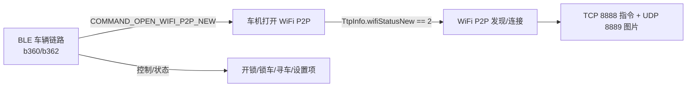
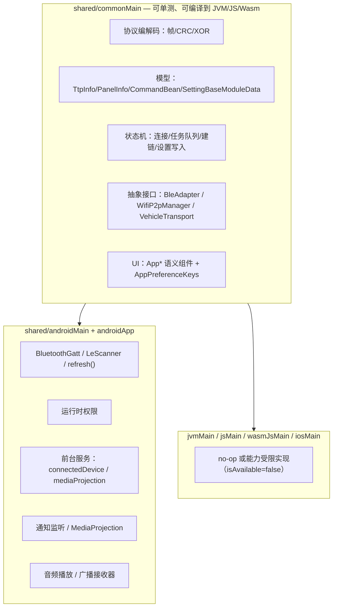

# YadeaHook/docs → toupin 落地计划

把 `F:/android app code/YadeaHook/docs`（25 个 md，全部来自 Yadea SmartMoto APK 的 smali 逆向对齐）
映射到当前 KMP 项目 `F:/android app code/toupin` 的实施路线。

> [!IMPORTANT]
> 这不是"抄一遍文档"。docs 描述的是一个 **Android 单体 APK**；toupin 是 **Kotlin Multiplatform
> Compose 双主题**项目。落地时必须重新分层：协议/状态机/模型进 `commonMain`，
> 系统能力（GATT、权限、前台服务、通知监听、MediaProjection）留在 `androidMain`，
> 并遵守 `AGENTS.md` 的 `App*` 组件与 `AppPreferenceKeys` 规范。

> [!NOTE]
> **docs 已不再是一手依据。** 已直接读取 `temp_smali/` 逐行核对，并修正了 docs 的多处结论。
> 字节码级事实见：
> - [smali-confirmed-facts.artifact.md](file:///C:/Users/DozenOregano696/AppData/Local/Google/AndroidStudio2026.2.1/projects/toupin.4c1ef0d2/.artifacts/b8e65a89-faca-48bd-bab3-80ebc22cbb4c/smali-confirmed-facts.artifact.md) — 可直接用于实现
> - [smali-deepdive.artifact.md](file:///C:/Users/DozenOregano696/AppData/Local/Google/AndroidStudio2026.2.1/projects/toupin.4c1ef0d2/.artifacts/b8e65a89-faca-48bd-bab3-80ebc22cbb4c/smali-deepdive.artifact.md) — token 与字段解析
> - [smali-verification.artifact.md](file:///C:/Users/DozenOregano696/AppData/Local/Google/AndroidStudio2026.2.1/projects/toupin.4c1ef0d2/.artifacts/b8e65a89-faca-48bd-bab3-80ebc22cbb4c/smali-verification.artifact.md) — 首轮验证与 docs 修正
> - [implementation-spec.artifact.md](file:///C:/Users/DozenOregano696/AppData/Local/Google/AndroidStudio2026.2.1/projects/toupin.4c1ef0d2/.artifacts/b8e65a89-faca-48bd-bab3-80ebc22cbb4c/implementation-spec.artifact.md) — 文件级实现规格

### 已确认的 docs 错误（必读）

| docs 说法 | smali 实际情况 |
| --- | --- |
| 固件/硬件版本都读 `2a26`（待确认） | ✅ 属实，是**真缺陷**；`2a27` 常量存在但零引用 |
| 配对握手细节无法证明 | ✅ 已确认：**32 字节 + XOR 收尾**的独立帧，需 token |
| `TtpInfo` 是带解析的实体 | ❌ 解析在 `l76.smali`（12724 行） |
| 看门狗 tick 1000ms | ❌ **未找到 `0x3e8`**；已确认 15s/20s/5s/500ms/200ms 五档 |
| —（未提） | ⚠️ `5944FFF0/FFF1/FFF2` 是**部件通道 UUID**，不是帧头 |
| —（未提） | ⚠️ **LE/BE 字节序混用**：`l76.H`/`e` 是 LE，`l76.J` 是 BE |

---

## 1. 文档清单与功能域归并

| 功能域 | 总入口 | 专题文档 |
| --- | --- | --- |
| 登录/账号 | `登录逻辑完整实现指南.md` | `login-api-analysis` / `login-network-model` / `login-session-interceptors` / `login-thirdparty-bind` / `login-ui-flows` |
| 车辆 BLE | `蓝牙连接逻辑完整实现指南.md` | `ble-connection-statemachine` / `ble-control-commands` / `ble-data-protocol` / `ble-vehicleservice-integration` / `vehicle-service-communication-analysis` |
| P2P 导航投屏 | `导航投屏完整实现指南.md` | `p2p-connection-layer` / `p2p-data-protocol` / `p2p-navigation-source` / `p2p-service-integration` |
| 车辆设置 | `车辆设置完整实现指南.md` | `car-settings-ui` / `car-settings-models-registry` / `car-settings-peripherals` / `car-settings-actions-request` |
| 应用侧附加功能 | `设备控制功能说明.md` | `速度警报设置说明.md` |

三条链路的关系（文档反复强调，最容易搞错）：



- **BLE 只负责"开门"和车辆控制/状态**，投屏数据全走 WiFi P2P。
- 现有项目的 BLE (`7e4000xx`) 是**投屏路径**，与车辆 BLE (`b360/b362/e7810b82`) 是**两套 UUID**，不能混用。

---

## 2. toupin 现状盘点

### 2.1 已有且可复用

| 模块 | 文件 | 复用点 |
| --- | --- | --- |
| 投屏协议 | [YadeaProtocol.kt](file:///F:/android%20app%20code/toupin/shared/src/commonMain/kotlin/top/ghhccghk/yadea/protocol/YadeaProtocol.kt) | `5944/4B4A` 外层帧、`3C` 内层、SUM8、CRC16-IBM、0x10~0x1F 类型、1434 分片 |
| 投屏 BLE | [BleProtocol.kt](file:///F:/android%20app%20code/toupin/shared/src/commonMain/kotlin/top/ghhccghk/yadea/ble/BleProtocol.kt) | 10 字节传输头、MTU 517、写节奏参数 |
| BLE 抽象 | [BleAdapter.kt](file:///F:/android%20app%20code/toupin/shared/src/commonMain/kotlin/top/ghhccghk/yadea/ble/BleAdapter.kt) | scan/connect/discover/read/write/notify/mtu + `expect createBleAdapter()` |
| Wi-Fi/P2P | [WifiP2pInterface.kt](file:///F:/android%20app%20code/toupin/shared/src/commonMain/kotlin/top/ghhccghk/yadea/wifi/WifiP2pInterface.kt) | peers/connectionState/groupOwnerIp/discover/connect |
| 传输层 | [FrameSender.kt](file:///F:/android%20app%20code/toupin/shared/src/commonMain/kotlin/top/ghhccghk/yadea/network/FrameSender.kt) | TCP 帧收发 + 粘包重组缓冲 |
| 投屏引擎 | [MirrorEngine.kt](file:///F:/android%20app%20code/toupin/shared/src/commonMain/kotlin/top/ghhccghk/yadea/mirror/MirrorEngine.kt) | 握手 0x20 → 帧循环 → 心跳 → NAV_END |
| 设置持久化 | [AppPreferences.kt](file:///F:/android%20app%20code/toupin/shared/src/commonMain/kotlin/top/ghhccghk/yadea/settings/AppPreferences.kt) | `AppPreferenceKeys` + `SCHEMA_VERSION=5` + 回退逻辑 |
| 双主题 UI | [UiComponents.kt](file:///F:/android%20app%20code/toupin/shared/src/commonMain/kotlin/top/ghhccghk/yadea/ui/UiComponents.kt) | `AppSection`/`AppListRow`/`AppSwitchPreference`/`AppSegmentedControl` |
| 前台服务范式 | [CaptureService.kt](file:///F:/android%20app%20code/toupin/androidApp/src/main/kotlin/top/ghhccghk/yadea/CaptureService.kt) | `mediaProjection` 类型前台服务，可照抄结构 |
| 测试基线 | `shared/src/jvmTest` | 130 用例，含协议/偏好/布局 |

### 2.2 缺口（docs 有、项目没有）

| 缺口 | 说明 |
| --- | --- |
| 车辆 BLE 协议 | 无 `b360/b362`、无 `e7810b82`、无车辆帧 `5944+ORDER_ID+LEN+PAYLOAD+SUM8+4B4A` |
| CRC 族 | 只有 CRC16-IBM；缺 CRC16-XMODEM、CRC32-MPEG-2、`XOR(i+10)` |
| 车辆状态解析 | 无 `TtpInfo`(295 字段)/`PanelInfo`/`FaultInfo`/`ScooterStatusInfo` |
| 连接状态机 | 无 15s 看门狗 / 20s 连接超时 / 5s 操作超时 / 任务队列 / 重连语义 |
| 命令体系 | 无 `CommandBean`、`t()` 映射表、约 180 个 `commandType` |
| 编排服务 | 无 `VehicleService` 等价物（单例/回调链/2000ms 节流/故障上报） |
| 建链状态机 | 现有是"手动点扫描 → 手动点连接"，无 BLE 开门 → 等 `wifiStatusNew==2` → P2P → TCP 自动串联 |
| 车辆设置 | 无 `SettingBaseModuleData` 族、Registry、双写链路（BLE + IoT） |
| 登录/账号 | 完全没有 HTTP 客户端、无网关 AES 签名、无 token 会话 |
| 应用侧功能 | 无速度警报、无 DG-LAB 控制 |
| 桌面小组件 | 无 AppWidget/Glance；docs 仅以 `CommandBean.isFromWidget` 字段体现 widget 语义 |

---

## 3. 跨平台边界（AGENTS.md 硬约束）



> [!WARNING]
> 当前 `createBleAdapter()` 的 Android 实现在部分分支抛 `UnsupportedOperationException`，
> 且 `jvm/js/wasm/ios` 缺少 `actual`。新增任何 `expect` 前必须先补齐这些平台的
> 安全实现，否则会直接破坏"不得为 Android 便利破坏其他目标编译"这条规则。

---

## 4. 分阶段实施计划

### Phase 0 — 决策对齐（不写代码）

必须先确认第 7 节的问题清单。其中"目标车型"和"是否移植登录"会改变 60% 的工作量。

### Phase 1 — 车辆 BLE 协议层（`commonMain`，纯函数）

新增**独立**协议对象，绝不改动现有 `BleProtocol` / `YadeaProtocol`。

| 文件 | 内容 |
| --- | --- |
| `ble/vehicle/YadeaVehicleBle.kt` | UUID 常量：`b360/b362`、`180a/2a29/2a26/2a28/2a27`、`e7810b82/bef8e7db/bef8e7da`、`e7810bd2/bef8e820/bef8e821`、滑板车 `6e400001/6e400002` |
| `ble/vehicle/VehicleFrame.kt` | 车辆控制帧：`5944 + ORDER_ID(0x3E/0x3A/0x3B) + LEN + PAYLOAD + SUM8 + 4B4A`；`increaseControlByte` 追加 `FF` 填充 |
| `ble/vehicle/ScooterFrame.kt` | CRC16-XMODEM + `out[i] = frame[i] XOR ((i+10) and 0xFF)` |
| `ble/vehicle/Checksums.kt` | SUM8、CRC16-XMODEM(poly 0x1021/init 0)、CRC32-MPEG-2(0x04C11DB7/init 0xFFFFFFFF) |
| `ble/vehicle/VehicleCommands.kt` | `CommandBean` + `t()` 映射表 + 自行车 3 字节命令（`07 01 01` 锁车 / `07 01 02` 开锁 / `07 01 03` 寻车 / `07 01 09` 坐垫）+ 滑板车 payload 表 |
| `ble/vehicle/VehicleStatus.kt` | `TtpInfo` / `PanelInfo` / `FaultInfo` / `ScooterStatusInfo` 解析；无效值全 1/-1 语义 |

> [!CAUTION]
> 投屏帧和车辆帧都用 `5944/4B4A`，但 **ORDER_ID 与 SUM8 覆盖范围不同**
> （投屏 `0x3C`，SUM8 覆盖 `3C+INNER_LEN+INNER_PACKET`；车辆 `0x3E`，SUM8 覆盖 `ORDER_ID+LEN+PAYLOAD`）。
> 两者必须各留一套构建函数，禁止复用同一个 `buildFrame`。

验证：`jvmTest` 用文档中的 payload hex 做对拍向量（锁车/开锁/寻车/齿轮/能量回收）。

### Phase 2 — 连接状态机（`commonMain` 纯逻辑）

| 文件 | 内容 |
| --- | --- |
| `ble/vehicle/VehicleConnectionState.kt` | 底层 5 态 + 对外 3 态 + `disconnectType` 1~9 分类 + 去重规则 |
| `ble/vehicle/VehicleConnectFlow.kt` | 事件/转移表；15s 看门狗、20s GATT 超时、5s 操作超时、5s×1 重连 |
| `ble/vehicle/InitTaskQueue.kt` | 固定 5 项任务：制造商名 → 固件 → 硬件 → 启用通知 → 查询整车状态；`maxRetries=2`（3 次）、成功 50ms、重试 200ms、超限跳过 |

关键语义（必须保留，勿"优化"）：

- 只有**连接中失败**才 5s 重连 1 次；已连接后断开、连接超时、服务发现失败**都不重连**。
- `status == 0x85(133) && newState == 0` → 反射 `BluetoothGatt.refresh()` 清缓存。
- 连上后延迟 500ms 才 `discoverServices()`。
- 通知节流：距上次 >100ms 立即发，否则延迟 110ms。

验证：假时钟 + 假适配器驱动状态机，覆盖超时/重试/断开分类/去重。

### Phase 3 — Android 传输增强 + 车辆服务编排

`androidMain`：

- 扩展 `AndroidBleAdapter`：MTU 结果回调、descriptor 写入、133 refresh、权限前置检查。
- 新增 `VehicleForegroundService`（`foregroundServiceType="connectedDevice"`），照 `CaptureService` 结构。

编排（`commonMain` 接口 + `androidMain` 实现）：

- `VehicleService`：lazy 单例、通知回调链、2000ms **严格大于**节流、故障上报、状态流分发。
- 故障上报 `POST bikeFault/insertBikeFaultFromBluetooth`：`protocol=241`，`faults` 为 `%02x` 倒序、前后加 `/`、大写（`[1,2] → "/02/01/"`）。

### Phase 4 — 建链编排（复用现有 P2P/TCP）

| 文件 | 内容 |
| --- | --- |
| `navi/NaviConnectType.kt` | `TFT_IMG/TFT/YILIAN/WIFI` 分流模型（ordinal 0/1/2/3） |
| `navi/WifiMirrorConnectFlow.kt` | BLE 发 `COMMAND_OPEN_WIFI_P2P_NEW` → 等 `wifiStatusNew==2` → P2P 发现/连接 → 取 GO IP → TCP `192.168.7.1:8888` |
| 复用 | [WifiP2pManager](file:///F:/android%20app%20code/toupin/shared/src/commonMain/kotlin/top/ghhccghk/yadea/wifi/WifiP2pInterface.kt) + [MirrorEngine](file:///F:/android%20app%20code/toupin/shared/src/commonMain/kotlin/top/ghhccghk/yadea/mirror/MirrorEngine.kt) |

P2P 细节：单连接模型、`WpsInfo.setup = 0`(PBC)、不设 `groupOwnerIntent`、
成功判据 `groupFormed && groupOwnerAddress != null`、`ConnectionMonitor` 3s 轮询失败**不自动重连**（TCP 层才有指数退避）。
超时：发现 15s / 连接 15s / 取 IP 3s。

### Phase 5 — 车辆设置

| 文件 | 内容 |
| --- | --- |
| `carsetting/SettingModels.kt` | `SettingBaseModuleData` 族、`SettingActionData`、`SettingClassification`(9 类) |
| `carsetting/SettingRegistry.kt` | 6 个主列表 Registry：安全守护/灯光音效/感应解锁/骑行控制/智慧充电/智能仪表 |
| `carsetting/SettingWriteFlow.kt` | 1000ms 防抖 + 乐观切换 + 失败回滚；BLE 用 `CommandTempBean`，IoT 走网络 |
| `carsetting/IotPolling.kt` | `checkSettingStatus` 1s × 最多 30 次，仅 `result == 0` 成功 |
| `ui/CarSettingsScreen.kt` | 只使用 `AppSection`/`AppListRow`/`AppSwitchPreference`/`AppSliderPreference` |

注意：丢车/低电量/位置切换是**网络 API**，不是 BLE 命令；`chargeUlVal` 有效范围 75–100。

### Phase 6 — 登录/账号（**已确认必需，升格为硬前置**）

> [!IMPORTANT]
> **用户已确认：账号体系必须实现，否则车辆验证连接信息拿不到。**
> 因此 Phase 6 不再是「可并行/可选」，而是 **Phase 2 握手的前置**。
> 逐行核对结果见 [auth-smali-facts.artifact.md](file:///C:/Users/DozenOregano696/AppData/Local/Google/AndroidStudio2026.2.1/projects/toupin.4c1ef0d2/.artifacts/b8e65a89-faca-48bd-bab3-80ebc22cbb4c/auth-smali-facts.artifact.md)。

| 层 | 内容 |
| --- | --- |
| 客户端 | 引入 Ktor client（各平台 engine） |
| 签名 | `gatewaySign = URLEncode(AES-ECB-PKCS5("gatewayTimestamp=<ms>&json=<json>"))`，**且需 JSON 规范化** |
| 拦截器 | 公共 Header（15 项）、网关签名、响应解密、业务码 `101000/100995` → token 失效、`405` → 时间校正 |
| 模型 | `UserInfoBean`（字段名即 JSON 名）、`OtherLoginBean`(0=微信/1=QQ) |
| 存储 | **不得**照抄 MMKV；走 `AppPreferenceKeys` 新增 `usr_token`/`usr_info`/`login_id`，`SCHEMA_VERSION` 5→6 + 迁移测试 |
| UI | 登录/注册/改密/绑定页面，只依赖 `App*` 语义组件 |

**11 个接口已逐字段确认**（见 auth-smali-facts §1）：
`user/loginByPassword`、`user/loginBySms`、`user/sendCode`、`user/sendCodeByEmail`、
`user/sendCode/third-mobile`、`user/registerByEmail`、`user/setPasswordByUserId`、
`user/updatePasswordByCode`、`user/bindOrChangeEmail`、`user/bindOrChangeMobile`、
`user/third-auth/openid-mobile/bind`。

**公共 Header 已全量确认**（auth-smali-facts §4）：`Authorization`、`req-id`、`request-agent`、
`deviceId`、`os`、`app-version`、`bike-series-code`、`app-name`、`app-version-num`、
`app-market`、`app-version-type`、`device-brand`、`phone-model`、`language`、`push-operator`。

校验规则必须严格照抄：手机号 `^1(3|4|5|6|7|8|9)\d{9}$`、海外 `^[0-9]{7,11}$`、
密码 `^[\"',./?!~_\-<>&*^%$@a-zA-Z0-9]{6,18}$`、验证码 `^[0-9]{4}`（恰好 4 位）。

> [!CAUTION]
> 密钥 `cIDJ9f05d1604703` 是硬编码对称密钥。移植前需确认是否接受把该密钥写入开源仓库，
> 否则应改为构建期注入或服务端代理。

> [!CAUTION]
> **签名依赖 JSON 字符串本身，字段顺序敏感。** 原实现用 `TreeMap`（按 key 字典序）
> 序列化，移植时用 `kotlinx.serialization` 也必须保证同样的字典序，
> 否则 `gatewaySign` 与服务端不一致且**报错模糊**。
> 另：签名前有一段 JSON 规范化（转义引号、数组/对象字符串去引号），漏掉同样会失败。

### Phase 7 — Android 桌面小组件（Glance）

> [!NOTE]
> 该需求**不在 docs 覆盖范围内**（docs 只在 `CommandBean.isFromWidget` 字段体现 widget 语义），
> 因此协议与状态语义需复用 Phase 1–4 的成果，不要另起一套。

| 文件 | 内容 |
| --- | --- |
| `androidApp/.../widget/VehicleWidgetProvider.kt` | `GlanceAppWidget` + `GlanceAppWidgetReceiver` |
| `androidApp/.../widget/VehicleWidgetState.kt` | 小组件状态：锁态、电量、连接态、最后更新时间 |
| `androidApp/.../widget/VehicleWidgetActions.kt` | `ActionCallback` → 派发 Intent 给前台服务 |
| `androidApp/src/main/res/xml/vehicle_widget_info.xml` | `AppWidgetProviderInfo`（尺寸/预览/可调整） |
| `commonMain/.../vehicle/VehicleCommandSource.kt` | 命令来源标记（`App`/`Widget`/`Voice`），对齐 docs 的 `isFromWidget` |

关键约束：

- **小组件不能自己维持 BLE 连接**（无长生命周期进程）。按钮必须经 Phase 3 的
  `VehicleForegroundService` 执行 GATT 写，小组件只负责派发意图与展示状态。
- **状态回推**：`VehicleService` 状态变化 → `updateAll(context)`；小组件侧状态持久化后冷启动可读。
- **不要污染 `commonMain`**：`glance-appwidget` 是 Android 专属依赖，只进 `androidApp`。
- **小组件不适用双主题**：AppWidget 走 `RemoteViews` 体系，`MiuixTheme`/`MaterialTheme` 无法注入；
  小组件需单独设计简化视觉（跟随系统深色模式），不能承诺与 App 内双主题一致。
- 与 `AppPreferenceKeys` 的边界：小组件只读业务状态，不直接读写偏好。

依赖：`androidx.glance:glance-appwidget:1.2.0`（可选 `glance-material3:1.2.0`）。

验证：`adb shell am broadcast` 触发更新；桌面手工添加/调整尺寸；应用进程被杀后冷启动读取状态。

### Phase 8 — 应用侧附加功能（可选，安全敏感）

- 速度警报：阈值 25 km/h、冷却 10s、音频路径 → 全部改为 `AppPreferenceKeys`。
- DG-LAB 设备控制：V2/V3 UUID、`0xB0` 指令、车速-强度曲线。
  > [!WARNING]
  > 这是**安全敏感**功能（人体电刺激）。文档本身提示"首次低强度、建议 ≤100"。
  > 需明确确认是否纳入本仓库。

### Phase 9 — 验证矩阵

```powershell
$env:GRADLE_USER_HOME = "C:\Users\DozenOregano696\.gradle"
.\gradlew.bat :shared:compileKotlinJvm :shared:compileKotlinJs :shared:compileKotlinWasmJs :shared:jvmTest
.\gradlew.bat :androidApp:assembleDebug :desktopApp:build
```

| 层 | 手段 |
| --- | --- |
| 协议 | payload hex 对拍向量（帧/CRC/XOR/SUM8） |
| 状态机 | 假时钟 + 假适配器，覆盖超时/重试/断开分类 |
| 解析 | TtpInfo 字段偏移/位宽/无效值对拍 |
| 偏好 | schema 迁移 + 损坏值回退（沿用 `AppPreferencesTest` 风格） |
| UI | Miuix/Material3 × 浅色/深色 × 窄屏/宽屏 |

---

## 5. 关键坑点清单

1. **UUID 冲突**：现有 `7e4000xx`（投屏）vs 车辆 `b360/b362`，必须两个协议对象并存。
2. **`5944FFF0/FFF1/FFF2` 是部件通道 UUID**，与 `5944` 帧头同名前缀，极易混淆。
3. **两套 `5944/4B4A` 帧结构不同**：车辆帧协议 ID `3E`/`3A`/`3B` + 变长 hex 长度；投屏帧 `3C` + BE32。
4. **两套字节序混用**：`l76.H`/`e` 是 LE，`l76.J` 是 BE，同一报文内不能统一处理。
5. **条件性 ×0.1 缩放**：等于哨兵时跳过，否则无效值 `-1.0f` 会变成 `-0.1f`。
6. **固件与硬件版本都读 `00002a26`**：已确认为真缺陷（`2a27` 零引用），建议修正为 `2a28/2a27`。
7. **握手帧需 token**：32 字节 + XOR 收尾，但 `isAuthToken == false` 可完全绕过。
8. **`onControlSuccess` 只是 GATT 写成功**，不是车辆执行 ACK，不能据此显示"开锁成功"。
9. **重连语义反直觉**：已连接后断开不自动重连。
10. **长度字段不补零、校验字段补零到 2 位**——两者规则不同。
11. **写入 >20 字节不自动分包**，只打警告。
12. **`S()` 节流是严格 `>` 2000ms 且全局字段**（非 per-device）。
13. **TCP 接收无粘包重组**（现有 `FrameSender.parseBufferedFrames` 已实现，属加分项）。
14. **原实现缺陷不要复制**：`l.P(mac)` 恒 false、`R()` 无调用点、`Disposable` 覆盖。
15. **合规**：故障上报、位置权限、推送注册 ID 都涉及隐私声明与 Play 政策。

---

## 6. 建议的落地顺序

```
Phase 1 协议层（已解阻，可立即开工）
   ├─ 免鉴权（isAuthToken=false）──→ Phase 2 状态机 ──→ Phase 3 编排 ──→ Phase 4 建链
   └─ 鉴权路径 ──→ Phase 6 登录/取 token（先于 Phase 2）      ↓            ↓
                                                        Phase 5 设置  Phase 7 小组件
Phase 8 附加功能（可选，安全敏感）
```

> [!IMPORTANT]
> **修正：Phase 6 不再总是可并行。** 握手帧需要 token，但 `isAuthToken == false` 时
> 完全跳过 token 获取。因此：
> - 目标场景**不需要登录** → Phase 6 可完全不做，`1 → 2 → 3 → 4 → 5 → 7`
> - 目标场景**需要账号** → 必须 `1 → 6 → 2 → 3 → 4 → 5 → 7`
>
> 该选择需先确认（见 §7 第 5 问）。

> [!IMPORTANT]
> **小组件依赖 Phase 3/4**：它需要 `VehicleForegroundService` 来执行 BLE 写，
> 因此不能提前做，否则按钮点了没有承载进程。

优先级理由：Phase 1–2 是纯 `commonMain` 逻辑，零平台风险且可 100% 单测。
协议层的关键未知项（帧格式、字节序、位域、校验、计时器）已全部有字节码证据，
可以先把最容易出错的部分钉死，不碰 Android。

---

## 7. 需要确认的问题

> [!IMPORTANT]
> 以下问题会显著改变实现范围，建议先回答再动工。
> 标 ✅ 的已由 smali 核对回答，标 ❓ 的仍需用户决策。

1. ❓ **目标车型**：自行车 / 滑板车(X1/EiBike) / 中控 Box？决定用哪套 UUID 与命令表。
2. ✅ **已确认共存**：投屏 `7e4000xx` 与车辆 `b360/b362` 是两套；且 `5944FFFx` 是部件 UUID。
   需拆成三个命名空间（投屏 / 车辆 / 部件）。
3. ❓ **"速度警报"指哪一个**？(a) 应用侧警报音 (b) DG-LAB 强度曲线 (c) 车端超速警报 —— 三者存储与交互完全不同。
4. ❓ **是否移植 DG-LAB 设备控制**？安全敏感。
5. ❓ **是否需要账号体系**？决定 Phase 6 是否必需：
   `isAuthToken == false` 时握手完全不需要 token（已确认）。
6. ✅ **已确认是真缺陷**（`wi.R0`/`wi.S0` 都传 `2a26`，`2a27` 零引用）。
   ❓ 仍需选择：复刻 / 修正为 `2a28`+`2a27`（推荐）/ 先试 `2a27` 再回退。
7. ❓ **是否需要 BLE 前台服务保活**，还是仅前台 UI 内连接？
8. ❓ **速度单位**：仅 km/h，还是需要英制？
9. ❓ **故障上报**是否接入后端？
10. ❓ **扫描过滤**：保留原实现"无 ScanFilter + MAC 精确匹配"，还是加 UUID/名称过滤（省电）？
11. ❓ **小组件提供哪些操作**？（开锁 / 锁车 / 寻车 / 只读电量与锁态）—— 决定是否需要前台服务常驻。
12. ❓ **小组件是否需要展示车辆实时状态**？若需要，App 不在运行时只能显示上次缓存值，需确认可接受的陈旧度。
13. ❓ **`TtpInfo` 字段移植范围**：先做已确认的 30+ 个，还是一次性录入 295 个？
